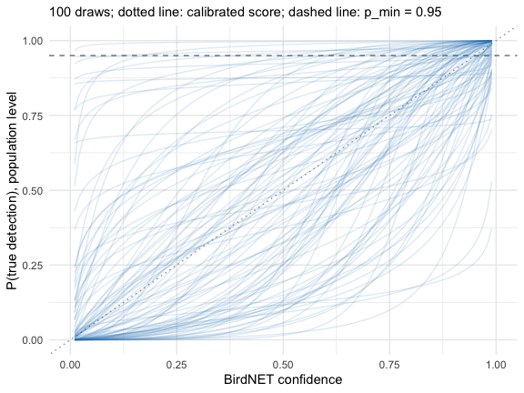
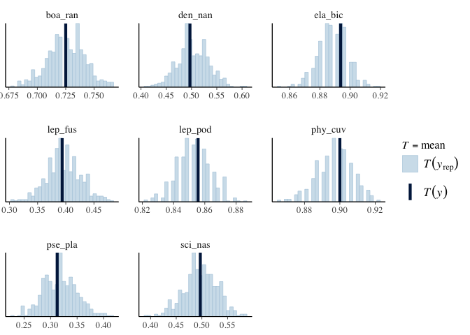
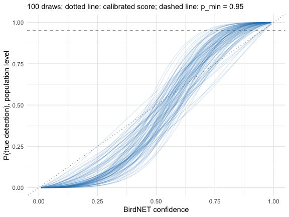
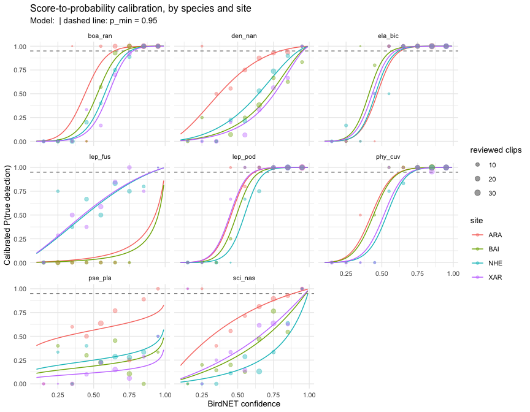

# Bayesian calibration with brms

The calibration of
[`vignette("calibration")`](https://provetelab.org/sheepdog/articles/calibration.md)
fits the candidate models by maximum likelihood with ‘lme4’. sheepdog
can also fit the selected model in a Bayesian framework with ‘brms’.
This gives three things the maximum likelihood fit does not:

- the uncertainty of the calibrated probability of every detection, and
  a rule that uses it (“is P(TP) \>= `p_min` with high posterior
  probability?”) instead of a point estimate;
- priors that regularise the variance components, which avoids the
  singular fits that ‘lme4’ gives when a correlation or a variance is
  estimated at the boundary;
- the propagation of the calibration uncertainty to the detection
  histories and the community matrices.

The cost is computing time and the need to state, and check, a prior.
The workflow below follows the steps of a Bayesian workflow: prior
predictive check, fit, convergence diagnostics, posterior predictive
check and sensitivity to the prior (Gelman et al. 2026; McElreath 2020).

``` r

library(sheepdog)
suppressPackageStartupMessages(library(dplyr))
ex <- system.file("extdata", "example", package = "sheepdog")
val_files <- list.files(file.path(ex, "validation"), full.names = TRUE)
val <- suppressMessages(read_validations(val_files))
```

## The model

We use the model retained by the log-loss rule in
[`vignette("calibration")`](https://provetelab.org/sheepdog/articles/calibration.md):
species slopes and intercepts without their correlation, and site x
species intercepts.

``` r

f <- calibration_models(uncorrelated = TRUE)$m5_species_x_site_uncorrelated
f
#> tp ~ logit_conf + (1 | species) + (0 + logit_conf | species) + 
#>     (1 | site:species)
#> <environment: 0x7725e09658>
```

## The prior

`fit_calibration(engine = "brms")` requires the prior to be given
explicitly: ‘brms’ would otherwise use flat priors on the slopes.
[`calibration_prior()`](https://provetelab.org/sheepdog/reference/calibration_prior.md)
builds a weakly informative example centred on the hypothesis that the
BirdNET score is already calibrated, P(TP) = score. The data then show
how far the classifier departs from it.

``` r

prior <- calibration_prior(f, val)
prior
#>               prior     class coef group resp dpar nlpar   lb   ub tag source
#>  normal(0.913, 1.5) Intercept                            <NA> <NA>       user
#>        normal(1, 1)         b                               0 <NA>       user
#>      exponential(1)        sd                            <NA> <NA>       user
```

- The slope of `logit_conf` is centred on 1 (a calibrated score), with a
  standard deviation of 1, and truncated at 0: a higher score never
  lowers P(TP).
- ‘brms’ centres the predictors, so the intercept is the logit of P(TP)
  at the mean logit score of the reviewed clips (0.913); centring its
  prior on that value makes slope 1 and intercept equal to the mean
  correspond to P(TP) = score.
- The standard deviations of the species and site x species effects get
  `exponential(1)`, most of whose mass lies on moderate differences on
  the logit scale.

### Prior predictive check

Before fitting, sample the model from the prior alone and look at the
calibration curves it implies on the probability scale.
[`plot_calibration_draws()`](https://provetelab.org/sheepdog/reference/plot_calibration_draws.md)
draws the population-level curve of 100 draws:

``` r

prior_fit <- prior_predictive_calibration(
  f, val, prior, chains = 2, iter = 1000, refresh = 0, silent = 2,
  backend = "cmdstanr", seed = 2026)
#> Carregando namespace exigido: rstan
plot_calibration_draws(prior_fit)
```



plot of chunk prior-check

The prior allows curves well above and well below the diagonal (a
calibrated score), all increasing; it rules out nothing a reviewer would
consider plausible, and it does not force the curves to cross `p_min` at
any particular score.

## Fitting

``` r

fit <- fit_calibration(val, f, engine = "brms", prior = prior,
                       chains = 4, cores = 4, iter = 2000,
                       control = list(adapt_delta = 0.95),
                       refresh = 0, silent = 2, backend = "cmdstanr",
                       seed = 2026)
```

[`fit_calibration()`](https://provetelab.org/sheepdog/reference/fit_calibration.md)
runs
[`calibration_diagnostics()`](https://provetelab.org/sheepdog/reference/calibration_diagnostics.md)
after the fit and warns when the largest R-hat exceeds 1.01, the bulk or
tail effective sample sizes fall below 400, or there are divergent
transitions:

``` r

calibration_diagnostics(fit)
#> # A tibble: 1 × 5
#>   max_rhat min_ess_bulk min_ess_tail n_divergent ok   
#>      <dbl>        <dbl>        <dbl>       <int> <lgl>
#> 1     1.01         788.        1450.           0 TRUE
```

A higher `adapt_delta` (here 0.95) is the first remedy for divergent
transitions; persistent divergences point to a model that the data
cannot identify.

``` r

summary(fit)$fixed
#>             Estimate Est.Error   l-95% CI  u-95% CI     Rhat Bulk_ESS Tail_ESS
#> Intercept  -0.391735 0.3658406 -1.1143408 0.3468419 1.000501 2388.154 2612.636
#> logit_conf  2.093138 0.5675039  0.9230704 3.1608814 1.003420 1280.111 1747.844
```

### Posterior predictive check

The observed proportion of true positives by species should fall within
the distribution of the proportions replicated from the posterior:

``` r

brms::pp_check(fit, type = "stat_grouped", group = "species",
               stat = "mean", ndraws = 500)
```



plot of chunk ppc

### Sensitivity to the prior

[`calibration_sensitivity()`](https://provetelab.org/sheepdog/reference/calibration_sensitivity.md)
runs the power-scaling analysis of ‘priorsense’ (Kallioinen et
al. 2024): it measures how much each population-level parameter and each
standard deviation changes when the prior or the likelihood is up- or
down-weighted.

``` r

sens <- calibration_sensitivity(fit)
sens
#> Sensitivity based on cjs_dist
#> Prior selection: all priors
#> Likelihood selection: all data
#> 
#>                    variable prior likelihood
#>                 b_Intercept 0.030      0.024
#>                b_logit_conf 0.119      0.039
#>  sd_site:species__Intercept 0.055      0.157
#>       sd_species__Intercept 0.112      0.076
#>      sd_species__logit_conf 0.126      0.048
#>                                 diagnosis
#>                                         -
#>  potential strong prior / weak likelihood
#>       potential prior-likelihood conflict
#>       potential prior-likelihood conflict
#>  potential strong prior / weak likelihood
```

A parameter sensitive to the prior but not to the likelihood (“strong
prior / weak likelihood”) is mostly determined by the prior; one
sensitive to both (“prior-likelihood conflict”) is pulled in different
directions by the prior and the data. Here the flagged standard
deviations are sd_site:species\_\_Intercept, sd_species\_\_Intercept,
sd_species\_\_logit_conf, and the flagged population-level parameters
are b_logit_conf. The standard deviations of the species effects, and
the population slope (the mean of the species slopes), are estimated
from only 8 species, so their prior matters. Two things follow. Report
the prior together with the results. And check that the conclusions (the
calibrated probabilities near `p_min`, the detection histories) do not
change under a wider prior, for instance `normal(1, 2)` on the slope:
with ‘priorsense’ this is what the power-scaling approximates without
refitting. With more species, the likelihood takes over and the flags
disappear.

### Posterior calibration curves

``` r

plot_calibration_draws(fit)
```



plot of chunk posterior-curves

The population-level curves are steeper than the diagonal (posterior
mean slope 2.09, 95 % interval 0.92 to 3.16): in the example, low scores
overestimate P(TP) and high scores underestimate it. The curves by
species and site, with the observed precision by score bin, are drawn by
[`plot_calibration()`](https://provetelab.org/sheepdog/reference/plot_calibration.md)
as for the ‘lme4’ fit:

``` r

plot_calibration(fit, val)
```



plot of chunk curves

## Scoring the detections

[`score_detections()`](https://provetelab.org/sheepdog/reference/score_detections.md)
computes the posterior of P(TP) once on a grid of scores (step 0.01) for
each site x species, and assigns it to the detections by their rounded
score; the cost does not depend on the number of detections. Each
detection gets the posterior mean (`p_tp`), a lower quantile
(`p_tp_lower`, 5 % by default) and the posterior probability that P(TP)
\>= `p_min` (`pr_reliable`):

``` r

sites <- c("ARA", "BAI", "NHE", "XAR")
tables <- setNames(file.path(ex, "birdnet", sites,
                             "BirdNET_SelectionTable.txt"), sites)
scored <- suppressMessages(score_detections(tables, fit, p_min = 0.95))
scored |>
  select(site, species, confidence, p_tp, p_tp_lower, pr_reliable) |>
  arrange(desc(confidence)) |>
  head()
#> # A tibble: 6 × 6
#>   site  species confidence  p_tp p_tp_lower pr_reliable
#>   <chr> <chr>        <dbl> <dbl>      <dbl>       <dbl>
#> 1 NHE   phy_cuv      0.995 1.000      1.000           1
#> 2 NHE   lep_pod      0.993 1.000      1.000           1
#> 3 XAR   lep_pod      0.993 1.000      1.000           1
#> 4 NHE   ela_bic      0.992 1.000      1.000           1
#> 5 ARA   boa_ran      0.991 1.000      1.000           1
#> 6 ARA   lep_pod      0.991 1.000      1.000           1
```

## Two rules for a reliable detection

[`detection_history()`](https://provetelab.org/sheepdog/reference/detection_history.md)
can count a detection as reliable when its posterior mean reaches
`p_min` (`rule = "mean"`, as with ‘lme4’) or when the posterior
probability that P(TP) \>= `p_min` reaches `prob_min`
(`rule = "probability"`):

``` r

h_mean <- detection_history(scored, p_min = 0.95)
h_prob <- detection_history(scored, p_min = 0.95, rule = "probability",
                            prob_min = 0.9)
tibble(rule = c("mean", "probability"),
       nights_k1 = c(sum(h_mean$detection_k1), sum(h_prob$detection_k1)),
       nights_k2 = c(sum(h_mean$detection_k2), sum(h_prob$detection_k2)))
#> # A tibble: 2 × 3
#>   rule        nights_k1 nights_k2
#>   <chr>           <int>     <int>
#> 1 mean              357       322
#> 2 probability       339       306
```

The probability rule is more conservative where the calibration is
uncertain, typically in cells with few reviewed clips, because it asks
that the calibrated probability exceed `p_min` with high posterior
probability rather than on average.

``` r

inner_join(count(h_mean, species, wt = detection_k1, name = "mean"),
           count(h_prob, species, wt = detection_k1, name = "probability"),
           by = "species")
#> # A tibble: 8 × 3
#>   species  mean probability
#>   <chr>   <int>       <int>
#> 1 boa_ran    68          68
#> 2 den_nan    30          21
#> 3 ela_bic    85          85
#> 4 lep_fus     3           0
#> 5 lep_pod    78          78
#> 6 phy_cuv    81          81
#> 7 pse_pla     0           0
#> 8 sci_nas    12           6
```

## Propagating the uncertainty to the community matrices

Both rules still produce a single history.
[`history_draws()`](https://provetelab.org/sheepdog/reference/history_draws.md)
rebuilds the history for each of `n_draws` posterior draws: in a draw, a
detection is reliable when its probability in that draw is \>= `p_min`.
The cost is again independent of the number of detections.

``` r

hd <- history_draws(fit, scored, p_min = 0.95, n_draws = 200)
hd
#> # A tibble: 174,400 × 10
#>     draw site  species night   n_detections n_reliable detection_k1 detection_k2
#>    <int> <chr> <chr>   <chr>          <int>      <int>        <int>        <int>
#>  1    33 ARA   boa_ran 202110…           10          2            1            1
#>  2    33 ARA   boa_ran 202110…           13          9            1            1
#>  3    33 ARA   boa_ran 202110…           16         10            1            1
#>  4    33 ARA   boa_ran 202110…           11          5            1            1
#>  5    33 ARA   boa_ran 202110…            8          3            1            1
#>  6    33 ARA   boa_ran 202111…           13          9            1            1
#>  7    33 ARA   boa_ran 202111…            9          5            1            1
#>  8    33 ARA   boa_ran 202111…           11          4            1            1
#>  9    33 ARA   boa_ran 202111…           12          7            1            1
#> 10    33 ARA   boa_ran 202111…            7          3            1            1
#> # ℹ 174,390 more rows
#> # ℹ 2 more variables: detection_k3 <int>, detection <int>
```

[`community_matrices_draws()`](https://provetelab.org/sheepdog/reference/community_matrices_draws.md)
builds the community matrices of
[`community_matrices()`](https://provetelab.org/sheepdog/reference/community_matrices.md)
for each draw and summarises each site x month x species frequency by
its posterior mean and a 90 % interval:

``` r

core <- c("boa_ran", "ela_bic", "lep_pod", "phy_cuv")
md <- community_matrices_draws(hd, core, k_min = 2, min_nights_month = 5)
md$summary |>
  mutate(width = frequency_upper - frequency_lower) |>
  arrange(desc(width)) |>
  head()
#> # A tibble: 6 × 8
#>   site  month   species n_nights_recorded frequency_mean frequency_lower
#>   <chr> <chr>   <chr>               <int>          <dbl>           <dbl>
#> 1 ARA   2022-01 lep_pod                 5          0.79              0.6
#> 2 XAR   2021-11 boa_ran                 5          0.918             0.6
#> 3 NHE   2021-11 boa_ran                 5          0.777             0.6
#> 4 XAR   2021-12 lep_pod                 5          0.62              0.6
#> 5 ARA   2021-12 ela_bic                 5          0.986             0.8
#> 6 BAI   2021-12 boa_ran                 5          0.834             0.8
#> # ℹ 2 more variables: frequency_upper <dbl>, width <dbl>
```

12 of the 92 site x month x species cells have a frequency that changes
among draws; the others are fixed because their detections are far above
or below `p_min` in every draw.

``` r

library(ggplot2)
ggplot(md$summary, aes(month, frequency_mean, colour = site, group = site)) +
  geom_pointrange(aes(ymin = frequency_lower, ymax = frequency_upper),
                  position = position_dodge(width = 0.5), size = 0.3) +
  facet_wrap(~ species) +
  labs(x = NULL, y = "Frequency of nights with detection (k = 2)",
       subtitle = "Posterior mean and 90 % interval over 200 draws") +
  theme_minimal(base_size = 10) +
  theme(axis.text.x = element_text(angle = 45, hjust = 1))
```


plot of chunk matrix-uncertainty

`md$draws` keeps the frequency of every draw, so that a downstream
analysis (an ordination, a GLLVM; see
[`vignette("community-matrices")`](https://provetelab.org/sheepdog/articles/community-matrices.md))
can be repeated on each draw and its results summarised over draws.

## The calibrate() wrapper

[`calibrate()`](https://provetelab.org/sheepdog/reference/calibrate.md)
takes the same options. The comparison of the candidate models still
uses maximum likelihood, which is fast; the selected model is then
refitted with ‘brms’. Passing `prior = calibration_prior` (the function)
builds the example prior for whichever model is selected:

``` r

res <- calibrate(val_files, tables, output_dir = "calibration",
                 select = "one_se_logloss", uncorrelated = TRUE,
                 engine = "brms", prior = calibration_prior,
                 brms_args = list(chains = 4, cores = 4,
                                  control = list(adapt_delta = 0.95),
                                  backend = "cmdstanr"),
                 rule = "probability", prob_min = 0.9)
```

[`calibrate()`](https://provetelab.org/sheepdog/reference/calibrate.md)
then also writes `calibration_diagnostics.csv`.

## References

Gelman, A., Vehtari, A., McElreath, R., Simpson, D., Margossian, C. C.,
Yao, Y., Kennedy, L., Gabry, J., Bürkner, P.-C., Modrák, M., & Leos
Barajas, V. (2026). *Bayesian Workflow*. Chapman & Hall.
<https://avehtari.github.io/Bayesian-Workflow/>

Kallioinen, N., Paananen, T., Bürkner, P.-C., & Vehtari, A. (2024).
Detecting and diagnosing prior and likelihood sensitivity with
power-scaling. *Statistics and Computing*, 34, 57.
<https://doi.org/10.1007/s11222-023-10366-5>

McElreath, R. (2020). *Statistical Rethinking: A Bayesian Course with
Examples in R and Stan* (2nd ed.). Chapman and Hall/CRC.
<https://doi.org/10.1201/9780429029608>
