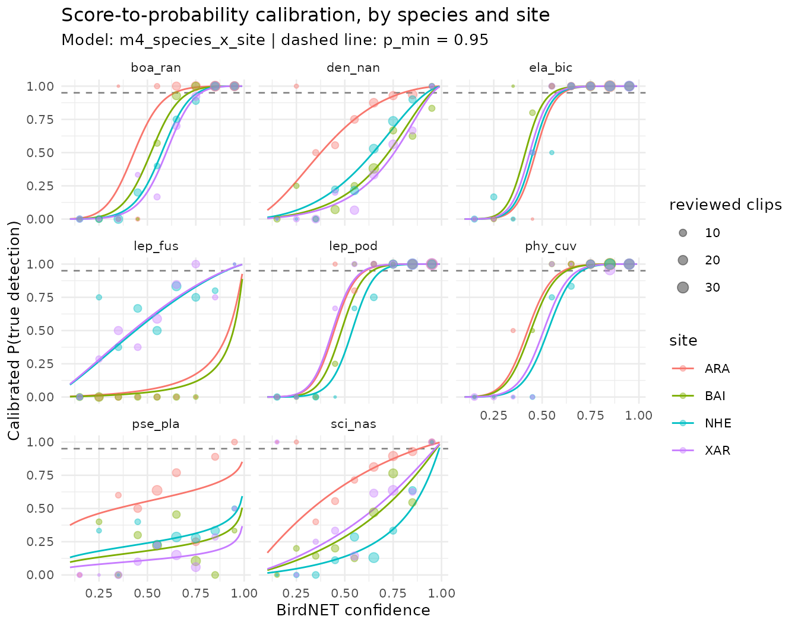

# Calibrating confidence scores

This vignette covers the second stage of sheepdog in detail: turning
BirdNET confidence scores into probabilities that a detection is a true
positive, scoring every detection, and building nightly detection
histories. Each step is run on the example data shipped with the
package.

``` r

library(sheepdog)
library(dplyr)
ex <- system.file("extdata", "example", package = "sheepdog")
```

## Why calibrate

A BirdNET confidence score is a classifier output in \[0, 1\], not a
probability that the detection is correct. The BirdNET authors recommend
converting the scores into probabilities of a true detection (Wood &
Kahl 2024). One way to do so, with a sample of manually validated
detections, is a logistic regression of the verdict on logit(score),
applied, for instance, by Owens et al. (2026).

One curve for all species is rarely enough. The same score can mean
different things for different species, because the score distributions
of true and false detections differ among species, and for the same
species at different sites, because the rate of false detections depends
on background noise and the rate of true ones on how often the species
is present. sheepdog therefore fits hierarchical logistic models in
which the intercept and the slope on logit(score) can vary among species
and among sites.

## The example data

The example data are simulated (`data-raw/make_example_data.R`). Eight
anuran species were recorded at four sites over six months, from October
2021 to March 2022. When a species is present, its true detections have
scores drawn from a species-specific Beta distribution. Every species
also produces false positives in every recording, present or not, with
scores drawn from a second species-specific Beta distribution. For five
species (`boa_ran`, `den_nan`, `lep_fus`, `pse_pla`, `sci_nas`) the two
distributions overlap widely; the other three (`ela_bic`, `lep_pod`,
`phy_cuv`) produce few false positives, with low scores, and are well
separated. The rate of false positives is multiplied by a site noise
factor (ARA 0.7, BAI 1.0, XAR 1.5, NHE 2.2). Presence varies with season
and site, including a random preference of each species for each site.
The same score therefore corresponds to different probabilities of a
true detection among species and sites. The verdicts of the reviewed
clips come from the simulated truth.

The reviewed clips are the `validation_by_clip_<site>.csv` tables
written by
[`post_validation()`](https://provetelab.org/sheepdog/reference/post_validation.md).
[`read_validations()`](https://provetelab.org/sheepdog/reference/read_validations.md)
stacks them, keeps the clips with a positive or negative verdict and a
confidence score, and adds `logit_conf` and the binary response `tp`.

``` r

val_files <- list.files(file.path(ex, "validation"), full.names = TRUE)
val <- read_validations(val_files)
#> 2467 reviewed clips (1577 TP / 890 FP) of 8 species at 4 sites.
table(val$site, val$species)
#>      
#>       boa_ran den_nan ela_bic lep_fus lep_pod phy_cuv pse_pla sci_nas
#>   ARA      80      80      80      33      80      80      80      80
#>   BAI      80      80      80      56      58      80      80      80
#>   NHE      80      80      80      80      80      80      80      80
#>   XAR      80      80      80      80      80      80      80      80
```

The clips were selected with the `"top"` design (the two highest scores
per site x species x night x hour, at most 80 per site x species). Cells
where a species was rarely detected hold fewer clips (as few as 33).
Precision differs widely among species:

``` r

val |>
  group_by(species) |>
  summarise(clips = n(), precision = mean(tp),
            min_conf = min(confidence), median_conf = median(confidence))
#> # A tibble: 8 × 5
#>   species clips precision min_conf median_conf
#>   <fct>   <int>     <dbl>    <dbl>       <dbl>
#> 1 boa_ran   320     0.725    0.101       0.753
#> 2 den_nan   320     0.497    0.108       0.641
#> 3 ela_bic   320     0.894    0.1         0.810
#> 4 lep_fus   249     0.394    0.105       0.490
#> 5 lep_pod   298     0.856    0.104       0.840
#> 6 phy_cuv   320     0.9      0.107       0.845
#> 7 pse_pla   320     0.312    0.106       0.648
#> 8 sci_nas   320     0.497    0.121       0.657
```

## Candidate models

[`calibration_models()`](https://provetelab.org/sheepdog/reference/calibration_models.md)
returns the family of candidate models. All of them are binomial
regressions of `tp` on `logit_conf`. They differ in how the calibration
curve is allowed to vary among species and sites.

``` r

models <- calibration_models()
cat(paste0(names(models), ": ", vapply(models, deparse1, "")), sep = "\n")
#> m0_global: tp ~ logit_conf
#> m1_species_intercept: tp ~ logit_conf + (1 | species)
#> m2_species_slope: tp ~ logit_conf + (logit_conf | species)
#> m3_plus_site: tp ~ logit_conf + (logit_conf | species) + (1 | site)
#> m4_species_x_site: tp ~ logit_conf + (logit_conf | species) + (1 | site:species)
```

- `m0_global`: one curve for all species and sites (a GLM).
- `m1_species_intercept`: species shift the curve along the score axis.
- `m2_species_slope`: species also differ in how steeply the probability
  rises with the score.
- `m3_plus_site`: as m2, plus a site intercept shared by all species.
- `m4_species_x_site`: as m2, plus an intercept for each site x species
  combination. This is the most flexible model.

Models m1 to m4 are binomial GLMMs fitted with
[`lme4::glmer()`](https://rdrr.io/pkg/lme4/man/glmer.html).

## Comparing models by cross-validation

[`compare_calibration_models()`](https://provetelab.org/sheepdog/reference/compare_calibration_models.md)
fits every candidate with k-fold cross-validation and computes the area
under the ROC curve (AUC) on the held-out folds. Folds are stratified
within site x species, so every level appears in both the training and
the test sets. The fold assignment uses a fixed `seed`. Five folds run
in a few seconds on these data.

``` r

cv <- compare_calibration_models(val, models, k_folds = 5)
#> Cross-validation (5 folds) of 5 models...
cv |> select(model, auc_mean, auc_sd, n_failed)
#> # A tibble: 5 × 4
#>   model                auc_mean  auc_sd n_failed
#>   <chr>                   <dbl>   <dbl>    <int>
#> 1 m4_species_x_site       0.942 0.00564        0
#> 2 m3_plus_site            0.928 0.00640        0
#> 3 m2_species_slope        0.916 0.00556        0
#> 4 m1_species_intercept    0.902 0.00544        0
#> 5 m0_global               0.862 0.0120         0
```

The table is ordered by mean AUC. Read the differences between models
together with the spread among folds (`auc_sd`), and check `n_failed`
(folds whose fit failed and were left out of the mean; none here). In
the example, each added level of structure raises the mean AUC by more
than the fold-to-fold standard deviation: from 0.862 for the global
model to 0.902 with species intercepts, 0.916 with species slopes, 0.928
with site intercepts and 0.942 with site x species intercepts. When
differences are of the same order as `auc_sd`, the order of the table
can change with `k_folds` or `seed`.

AUC measures discrimination (whether true detections score higher than
false ones), not calibration (whether a predicted probability of 0.9 is
correct nine times in ten). Two models with equal AUC can still give
different probabilities, so the comparison is a first filter, not the
whole decision.

When the leading models are close, a simple heuristic is to keep the
least complex model whose mean AUC is within one standard deviation of
the best one. This is a judgement call, not a rule implemented by the
package:

``` r

complexity <- match(cv$model, names(models))
within_1sd <- cv$auc_mean >= cv$auc_mean[1] - cv$auc_sd[1]
parsimonious <- cv$model[within_1sd][which.min(complexity[within_1sd])]
parsimonious
#> [1] "m4_species_x_site"
```

The wrapper
[`calibrate()`](https://provetelab.org/sheepdog/reference/calibrate.md)
takes the first row of the table (m4_species_x_site); the heuristic
retains m4_species_x_site. In the example the two agree, because no
simpler model comes within one standard deviation of the best. Whether
the retained model is a sound fit is a separate question, taken up next.

## Fitting the calibration model

[`fit_calibration()`](https://provetelab.org/sheepdog/reference/fit_calibration.md)
fits a model to all the reviewed clips and stores the species and site
levels with it, for
[`score_detections()`](https://provetelab.org/sheepdog/reference/score_detections.md)
and
[`plot_calibration()`](https://provetelab.org/sheepdog/reference/plot_calibration.md).
We fit every candidate, because whether a GLMM is singular is part of
the choice:

``` r

fits <- lapply(models, function(f) fit_calibration(val, f))
#> Warning: Singular fit (boundary) of the calibration model tp ~ logit_conf +
#> (logit_conf | species) + (1 | site:species): a variance component is estimated
#> at zero or a correlation at +-1. Check lme4::VarCorr(fit) and consider a
#> simpler model.
vapply(fits[-1], lme4::isSingular, logical(1))
#> m1_species_intercept     m2_species_slope         m3_plus_site 
#>                FALSE                FALSE                FALSE 
#>    m4_species_x_site 
#>                 TRUE
```

``` r

fit_global <- fits$m0_global
fit_full   <- fits$m4_species_x_site
coef(fit_global)
#> (Intercept)  logit_conf 
#>  -0.5310926   1.5993695
lme4::fixef(fit_full)
#> (Intercept)  logit_conf 
#>  -0.2816421   2.7948431
lme4::VarCorr(fit_full)
#>  Groups       Name        Std.Dev. Corr  
#>  site:species (Intercept) 1.19448        
#>  species      (Intercept) 0.81804        
#>               logit_conf  1.89240  1.000
```

The site x species intercepts of m4 have a standard deviation of 1.19 on
the logit scale, a large effect: at a given score, the odds of a true
detection differ several-fold among sites for the same species. The fit
is nevertheless singular, which is why
[`fit_calibration()`](https://provetelab.org/sheepdog/reference/fit_calibration.md)
warned above (it is the only singular fit among the candidates): the
correlation between the species intercepts and slopes is estimated at 1,
on the boundary of its range. With 8 species, a correlation between two
random effects is poorly identified. A singular fit means that the
random-effect structure is more complex than the data can support. The
predictions can still be used, but this variance component should not be
interpreted. The singularity lies in the species term, not in the site x
species term that gives m4 its advantage. m2 and m3 share the same
species term and are not flagged as singular, but in m3 the correlation
is already 0.98, close to the boundary: the species intercepts and
slopes are nearly collinear in every model. Here the choice is between
m4, singular in a component that does not drive its predictions but
clearly better in the cross-validation, and m3, a regular fit with a
lower AUC. We keep m4 for the rest of the vignette and do not interpret
its species correlation. Fitting m4 without the correlation (with
`(1 | species) + (0 + logit_conf | species)`) would be a further option,
but it is not one of the built-in candidates.

## Calibration curves

[`plot_calibration()`](https://provetelab.org/sheepdog/reference/plot_calibration.md)
draws the calibrated probability against the score, one panel per
species and one line per site. The points give the observed precision of
the reviewed clips in 0.1-wide score bins, sized by the number of clips.
The dashed line marks `p_min`.

``` r

plot_calibration(fit_full, val, p_min = 0.95, model_name = "m4_species_x_site")
```



Look for:

- **Flat or shallow curves.** A species whose curve rises slowly, or
  never reaches `p_min`, is poorly separated from its false positives.
  Its calibrated detections should not enter the analyses, or only in a
  sensitivity analysis.
- **Sites that diverge.** A site whose curve lies far from the others
  for the same species may differ in noise, in the number of false
  positives, or in the review. Check its clips before trusting its
  probabilities.
- **Curves that miss the points.** Systematic departures from the
  observed precision indicate lack of fit, usually in the score bins
  with the largest points.
- **Few clips.** Curves supported by small points (few clips per bin)
  are extrapolations. The `"top"` design gives few clips at low scores,
  so the lower part of each curve rests mainly on the shared fixed
  effects.

In the example, all of these appear. The three well-separated species
(`ela_bic`, `lep_pod`, `phy_cuv`) have steep curves that cross `p_min`
at moderate scores and lie close together among sites. `pse_pla` has a
shallow curve that stays below `p_min` at every site: its false
positives overlap its true detections too much for any score to be
reliable. `sci_nas` and `den_nan` reach `p_min` only near the top of the
score range, except at ARA, the quietest site, where their curves lie to
the left. `lep_fus` diverges most among sites: its curves at ARA and BAI
lie far below those at NHE and XAR. The species is rarely present at ARA
and BAI, so most of its detections there are false, and these two cells
also hold the fewest reviewed clips.

The practical consequence is the score at which each site x species
reaches `p_min`. Under the global model this score is the same
everywhere:

``` r

grid <- tidyr::expand_grid(
  species    = factor(levels(val$species), levels = levels(val$species)),
  site       = factor(levels(val$site), levels = levels(val$site)),
  confidence = seq(0.10, 0.99, by = 0.01)
) |>
  mutate(logit_conf = qlogis(confidence),
         p_global   = predict(fit_global, newdata = pick(everything()),
                              type = "response"),
         p_full     = predict(fit_full, newdata = pick(everything()),
                              type = "response"))

# lowest score with P(TP) >= 0.95; NA if never reached below 0.99
first_conf <- function(conf, p) {
  if (any(p >= 0.95)) min(conf[p >= 0.95]) else NA_real_
}
thresholds <- grid |>
  group_by(species, site) |>
  summarise(conf_global = first_conf(confidence, p_global),
            conf_full   = first_conf(confidence, p_full),
            .groups = "drop")
thresholds |> print(n = Inf)
#> # A tibble: 32 × 4
#>    species site  conf_global conf_full
#>    <fct>   <fct>       <dbl>     <dbl>
#>  1 boa_ran ARA           0.9      0.65
#>  2 boa_ran BAI           0.9      0.72
#>  3 boa_ran NHE           0.9      0.77
#>  4 boa_ran XAR           0.9      0.78
#>  5 den_nan ARA           0.9      0.8 
#>  6 den_nan BAI           0.9      0.95
#>  7 den_nan NHE           0.9      0.93
#>  8 den_nan XAR           0.9      0.96
#>  9 ela_bic ARA           0.9      0.61
#> 10 ela_bic BAI           0.9      0.56
#> 11 ela_bic NHE           0.9      0.6 
#> 12 ela_bic XAR           0.9      0.58
#> 13 lep_fus ARA           0.9     NA   
#> 14 lep_fus BAI           0.9     NA   
#> 15 lep_fus NHE           0.9      0.91
#> 16 lep_fus XAR           0.9      0.91
#> 17 lep_pod ARA           0.9      0.61
#> 18 lep_pod BAI           0.9      0.65
#> 19 lep_pod NHE           0.9      0.7 
#> 20 lep_pod XAR           0.9      0.6 
#> 21 phy_cuv ARA           0.9      0.62
#> 22 phy_cuv BAI           0.9      0.63
#> 23 phy_cuv NHE           0.9      0.71
#> 24 phy_cuv XAR           0.9      0.69
#> 25 pse_pla ARA           0.9     NA   
#> 26 pse_pla BAI           0.9     NA   
#> 27 pse_pla NHE           0.9     NA   
#> 28 pse_pla XAR           0.9     NA   
#> 29 sci_nas ARA           0.9      0.89
#> 30 sci_nas BAI           0.9      0.98
#> 31 sci_nas NHE           0.9      0.99
#> 32 sci_nas XAR           0.9      0.97
```

Under m4, the score needed to reach P(TP) \>= 0.95 ranges from 0.56 to
0.99 among site x species combinations, and 6 combinations (lep_fus,
pse_pla) never reach it, against a single threshold of 0.9 under the
global model. A single score threshold, or a single calibration curve,
would be too lenient for some species and sites and too strict for
others.

## Scoring every detection

[`score_detections()`](https://provetelab.org/sheepdog/reference/score_detections.md)
reads the complete selection tables (not only the reviewed clips) and
predicts P(TP) for every detection of a calibrated species. The tables
are passed as a vector named by site; the names must match the sites of
the calibration. A site absent from the calibration is scored with the
species effects only, with a warning. The night of a detection is its
recording date, or the day before for recordings that start before
`dawn_hour`.

``` r

sites  <- c("ARA", "XAR", "BAI", "NHE")
tables <- setNames(file.path(ex, "birdnet", sites,
                             "BirdNET_SelectionTable.txt"), sites)
scored <- score_detections(tables, fit_full, min_confidence = 0.1) |>
  suppressMessages()  # one line per site with the number of detections
scored |> select(site, species, night, confidence, p_tp)
#> # A tibble: 7,553 × 5
#>    site  species night    confidence   p_tp
#>    <chr> <fct>   <chr>         <dbl>  <dbl>
#>  1 ARA   boa_ran 20211001      0.504 0.734 
#>  2 ARA   den_nan 20211001      0.372 0.493 
#>  3 ARA   lep_fus 20211001      0.267 0.0173
#>  4 ARA   pse_pla 20211001      0.873 0.702 
#>  5 ARA   lep_pod 20211001      0.846 1.000 
#>  6 ARA   lep_pod 20211001      0.479 0.648 
#>  7 ARA   boa_ran 20211001      0.739 0.989 
#>  8 ARA   sci_nas 20211001      0.804 0.907 
#>  9 ARA   den_nan 20211001      0.240 0.267 
#> 10 ARA   sci_nas 20211001      0.623 0.785 
#> # ℹ 7,543 more rows
```

## Nightly detection histories

[`detection_history()`](https://provetelab.org/sheepdog/reference/detection_history.md)
aggregates the scored detections by site x species x night. A detection
is reliable when its calibrated probability is at least `p_min`; the
threshold applies to P(TP), not to the score. A night has a detection
when it holds at least k reliable detections (`min_detections_night`,
the repetition rule). The columns `detection_k1` to `detection_k3` give
the same rule with k = 1, 2 and 3; `detection` uses the chosen k.

``` r

history <- detection_history(scored, p_min = 0.95, min_detections_night = 1)
history
#> # A tibble: 872 × 10
#>    site  species night    n_detections n_reliable p_tp_max detection_k1
#>    <chr> <fct>   <chr>           <int>      <int>    <dbl>        <int>
#>  1 ARA   boa_ran 20211001           10          4    0.999            1
#>  2 ARA   boa_ran 20211006           13         10    1.000            1
#>  3 ARA   boa_ran 20211011           16         12    1.000            1
#>  4 ARA   boa_ran 20211016           11          5    1.000            1
#>  5 ARA   boa_ran 20211021            8          3    1.000            1
#>  6 ARA   boa_ran 20211101           13          9    1.000            1
#>  7 ARA   boa_ran 20211106            9          7    1.000            1
#>  8 ARA   boa_ran 20211111           11          5    0.997            1
#>  9 ARA   boa_ran 20211116           12          8    1.000            1
#> 10 ARA   boa_ran 20211121            7          3    0.999            1
#> # ℹ 862 more rows
#> # ℹ 3 more variables: detection_k2 <int>, detection_k3 <int>, detection <int>
summarise_history(history) |> print(n = Inf)
#> # A tibble: 32 × 6
#>    site  species nights nights_k1 nights_k2 nights_k3
#>    <chr> <fct>    <int>     <int>     <int>     <int>
#>  1 ARA   boa_ran     30        30        30        29
#>  2 ARA   den_nan     30        22        12         6
#>  3 ARA   ela_bic     24        20        20        20
#>  4 ARA   lep_fus     21         0         0         0
#>  5 ARA   lep_pod     22        20        18        17
#>  6 ARA   phy_cuv     24        21        20        20
#>  7 ARA   pse_pla     30         0         0         0
#>  8 ARA   sci_nas     30        11         4         0
#>  9 BAI   boa_ran     29        15        14        13
#> 10 BAI   den_nan     30         3         1         0
#> 11 BAI   ela_bic     22        20        20        20
#> 12 BAI   lep_fus     24         0         0         0
#> 13 BAI   lep_pod     18        10        10        10
#> 14 BAI   phy_cuv     26        20        20        19
#> 15 BAI   pse_pla     30         0         0         0
#> 16 BAI   sci_nas     30         0         0         0
#> 17 NHE   boa_ran     29        10         9         7
#> 18 NHE   den_nan     30         5         1         0
#> 19 NHE   ela_bic     28        20        20        20
#> 20 NHE   lep_fus     30         2         0         0
#> 21 NHE   lep_pod     28        20        20        19
#> 22 NHE   phy_cuv     29        25        25        24
#> 23 NHE   pse_pla     30         0         0         0
#> 24 NHE   sci_nas     30         0         0         0
#> 25 XAR   boa_ran     27        13        13         9
#> 26 XAR   den_nan     28         0         0         0
#> 27 XAR   ela_bic     27        25        25        22
#> 28 XAR   lep_fus     28         1         0         0
#> 29 XAR   lep_pod     28        28        26        25
#> 30 XAR   phy_cuv     24        15        15        14
#> 31 XAR   pse_pla     28         0         0         0
#> 32 XAR   sci_nas     28         2         0         0
```

`nights` counts the nights with any scored detection, and `nights_k1` to
`nights_k3` the nights with a detection under each rule. The gap between
`nights` and `nights_k1` is the number of nights whose detections were
all below `p_min`: nights that a rule on the raw output (any detection
above `min_confidence`) would have counted as detections. Species whose
curves never reach `p_min` have no night with a detection, whatever
their scores.

## Choosing p_min and k

`p_min` and k trade false-positive nights against missed nights. A high
`p_min` with k = 1 accepts a night on one very reliable detection; a
lower `p_min` with k = 2 or 3 requires repeated, moderately reliable
detections. The choice should follow the analysis: occupancy models with
false-positive parameters can tolerate a lenient rule, whereas analyses
with no false-positive component (for example, ordinations of community
matrices) call for a strict one. The sensitivity of the number of nights
with a detection to both settings is cheap to check:

``` r

sensitivity <- lapply(c(0.80, 0.90, 0.95, 0.99), function(p) {
  detection_history(scored, p_min = p) |>
    summarise(p_min = p, k1 = sum(detection_k1), k2 = sum(detection_k2),
              k3 = sum(detection_k3))
}) |>
  bind_rows()
sensitivity
#> # A tibble: 4 × 4
#>   p_min    k1    k2    k3
#>   <dbl> <int> <int> <int>
#> 1  0.8    460   400   360
#> 2  0.9    394   351   318
#> 3  0.95   358   323   294
#> 4  0.99   315   288   258
```

The number of nights with a detection under k = 1 falls from 460 to 315
across this range of `p_min`. If the conclusions of the downstream
analysis change across the range, report the results under more than one
setting.

The same check applies to the choice of model. Scoring with the global
model and comparing the histories shows how many site x species x nights
change, and for which species:

``` r

history_global <- score_detections(tables, fit_global) |>
  suppressMessages() |>
  detection_history(p_min = 0.95)
compare <- inner_join(history, history_global,
                      by = c("site", "species", "night"),
                      suffix = c("_full", "_global"))
compare_sp <- compare |>
  group_by(species) |>
  summarise(nights = n(),
            k1_full = sum(detection_k1_full),
            k1_global = sum(detection_k1_global),
            differ_k1 = sum(detection_k1_full != detection_k1_global))
compare_sp
#> # A tibble: 8 × 5
#>   species nights k1_full k1_global differ_k1
#>   <fct>    <int>   <int>     <int>     <int>
#> 1 boa_ran    115      68        50        18
#> 2 den_nan    118      30        22        22
#> 3 ela_bic    101      85        65        20
#> 4 lep_fus    103       3         4         1
#> 5 lep_pod     96      78        66        12
#> 6 phy_cuv    103      81        66        15
#> 7 pse_pla    118       0        21        21
#> 8 sci_nas    118      13        29        18
```

The global model changes the history of 127 of 872 site x species x
nights under k = 1. It accepts fewer nights than m4 for boa_ran,
den_nan, ela_bic, lep_pod, phy_cuv, which reach P(TP) \>= 0.95 below the
common threshold at some or all sites, and more nights for lep_fus,
pse_pla, sci_nas, whose calibrated probabilities m4 places lower.

## When the global model is enough

The global model is enough when the hierarchical models do not improve
the cross-validated AUC beyond the fold-to-fold variation, when the
species and site curves of a hierarchical model lie close together near
`p_min`, and when the detection histories do not change between models.
None of these holds in the example. With very few species or sites the
variance components are poorly estimated, and a simpler model (a species
effect only, or the global model) is the more defensible choice; with
many species, or species and sites known to differ in noise, the
hierarchical models keep the threshold on P(TP) consistent across them.

## Model checks

Before using calibrated probabilities, check that:

1.  **The GLMM converged.**
    [`fit_calibration()`](https://provetelab.org/sheepdog/reference/fit_calibration.md)
    warns when the refitted model is singular, as it did for m4 above,
    and convergence warnings of
    [`lme4::glmer()`](https://rdrr.io/pkg/lme4/man/glmer.html) are
    passed on.
    [`compare_calibration_models()`](https://provetelab.org/sheepdog/reference/compare_calibration_models.md)
    drops a fold whose fit fails from the mean AUC, warns about it and
    counts it in `n_failed`. Inspect the refitted model directly:

    ``` r

    lme4::isSingular(fit_full)
    #> [1] TRUE
    fit_full@optinfo$conv$lme4$messages
    #> [1] "boundary (singular) fit: see help('isSingular')"
    ```

    Here the only message is the singular fit discussed above; there are
    no convergence warnings. Convergence warnings (as opposed to a
    singular fit) mean the estimates should not be used: simplify the
    random-effect structure, or review more clips.

2.  **The cross-validation supports the choice.** Read `auc_sd` with
    `auc_mean`. Do not prefer a more complex model on a difference
    smaller than the fold-to-fold variation.

3.  **The calibration curves are sensible.** Curves should increase with
    the score, follow the observed precision, and rest on enough clips
    near `p_min`.
    [`calibration_effort()`](https://provetelab.org/sheepdog/reference/calibration_effort.md)
    estimates how many clips per site x species are needed for a stable
    AUC.

The calibration also assumes that, within a score level, the reviewed
clips are representative of all the detections of that species at that
site. The model is conditional on the score, so the `"top"` design,
which oversamples high scores, does not bias it as long as this holds.
It fails if the clips were chosen by another criterion related to
correctness (for example, only clips that sounded clear, or only the
nights of peak activity), or if the reviewed period differs from the
scored one in noise or in species composition.

## The calibrate() wrapper

[`calibrate()`](https://provetelab.org/sheepdog/reference/calibrate.md)
runs the whole stage in one call. It reads the clips, compares the
candidate models, refits the best one by mean AUC, plots the calibration
curves (if ggplot2 is installed), scores every detection, builds the
detection history and writes all the outputs to `output_dir`. It refits
the model with the highest mean AUC; when that refit is singular, as m4
is here, it warns (through
[`fit_calibration()`](https://provetelab.org/sheepdog/reference/fit_calibration.md))
but keeps the model. Read the comparison, `calibration_model.txt` and
the curves it writes before using its output, and refit a simpler model
with
[`fit_calibration()`](https://provetelab.org/sheepdog/reference/fit_calibration.md)
if the comparison supports it.

``` r

out_dir <- file.path(tempdir(), "calibration")
res <- calibrate(validation_files  = val_files,
                 prediction_tables = tables,
                 output_dir        = out_dir,
                 p_min = 0.95, min_detections_night = 1, k_folds = 5) |>
  suppressMessages()
#> Warning: Singular fit (boundary) of the calibration model tp ~ logit_conf +
#> (logit_conf | species) + (1 | site:species): a variance component is estimated
#> at zero or a correlation at +-1. Check lme4::VarCorr(fit) and consider a
#> simpler model.
res$comparison$model[1]  # the model calibrate() refitted
#> [1] "m4_species_x_site"
list.files(out_dir)
#>  [1] "calibrated_detections_ARA.csv" "calibrated_detections_BAI.csv"
#>  [3] "calibrated_detections_NHE.csv" "calibrated_detections_XAR.csv"
#>  [5] "calibration_curves.png"        "calibration_model.rds"        
#>  [7] "calibration_model.txt"         "detection_summary.csv"        
#>  [9] "model_comparison.csv"          "nightly_detection_history.csv"
```

`nightly_detection_history.csv` is the input of the occupancy and
community analyses (see
[`vignette("frognet-workflow")`](https://provetelab.org/sheepdog/articles/frognet-workflow.md)).
Five folds and the example’s 2467 clips run in seconds; a project with
thousands of clips and many species takes longer, and
`effort_curve = TRUE` adds the effort curve.

## References

Owens, G., Wood, C. M., Hunt, T. J., Bussolini, L. T., Kreisl, A.,
Alves, F., & Stojanovic, D. (2026). Passive acoustic monitoring of the
rare orange-bellied parrot: automated detection using BirdNET-based
transfer learning. *bioRxiv*.
<https://doi.org/10.64898/2026.06.01.729442>

Wood, C. M., & Kahl, S. (2024). Guidelines for appropriate use of
BirdNET scores and other detector outputs. *Journal of Ornithology*,
165, 777–782. <https://doi.org/10.1007/s10336-024-02144-5>
