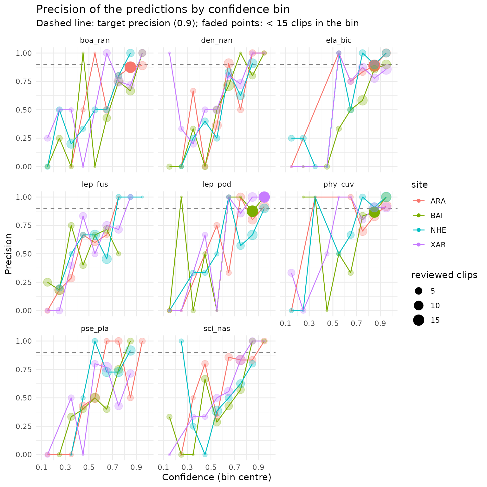

# Primeiros passos com o sheepdog

> **Tradução.** Este artigo é uma tradução da versão em inglês, que é a
> referência: [Get started with
> sheepdog](https://provetelab.org/sheepdog/articles/sheepdog.md).
> Traduzido da versão 3.2.1 do pacote; se as duas divergirem, vale a
> versão em inglês.

O sheepdog verifica se as detecções de um classificador personalizado
(*custom classifier*) do ‘BirdNET’ são reais. Sua primeira etapa,
tratada aqui, monta um conjunto de clipes para revisão manual a partir
das tabelas de seleção (*selection tables*) do BirdNET e resume os
vereditos dos revisores. A calibração (etapa 2) e as matrizes de
comunidade (etapa 3) são tratadas em outros artigos (ver [Próximos
passos](#where-next)).

``` r

library(sheepdog)
```

## Dados de exemplo

O pacote inclui um pequeno conjunto de dados simulados: tabelas de
seleção do BirdNET (formato Raven) de vários locais gravados de outubro
de 2021 a março de 2022, com predições de um classificador personalizado
para espécies de anuros. As taxas de falsos positivos (*false
positives*) variam entre espécies e locais, e os scores de confiança dos
falsos positivos se sobrepõem aos das detecções verdadeiras. O gerador é
`data-raw/make_example_data.R` no repositório do código-fonte. A coluna
`Begin Path` aponta para gravações em um drive de rede fictício
(`N:\pam\audio\...`); os arquivos de áudio em si não são distribuídos.

``` r

ex <- system.file("extdata", "example", package = "sheepdog")
list.files(file.path(ex, "birdnet"), recursive = TRUE)
#> [1] "ARA/BirdNET_SelectionTable.txt" "BAI/BirdNET_SelectionTable.txt"
#> [3] "NHE/BirdNET_SelectionTable.txt" "XAR/BirdNET_SelectionTable.txt"
```

## Leitura das tabelas de seleção

[`read_selection_tables()`](https://provetelab.org/sheepdog/reference/read_selection_tables.md)
encontra todas as tabelas de seleção dentro de uma pasta, lê e empilha
essas tabelas. O local é obtido do nome da pasta que contém cada tabela,
e os nomes das colunas são padronizados (por exemplo, `Begin Time (s)`
passa a `begin_time`).

``` r

det <- read_selection_tables(file.path(ex, "birdnet"))
#> 4 selection table(s) found:
#>   - /home/runner/work/_temp/Library/sheepdog/extdata/example/birdnet/ARA/BirdNET_SelectionTable.txt
#>   - /home/runner/work/_temp/Library/sheepdog/extdata/example/birdnet/BAI/BirdNET_SelectionTable.txt
#>   - /home/runner/work/_temp/Library/sheepdog/extdata/example/birdnet/NHE/BirdNET_SelectionTable.txt
#>   - /home/runner/work/_temp/Library/sheepdog/extdata/example/birdnet/XAR/BirdNET_SelectionTable.txt
#> 7553 predictions read from 4 site(s).
det |>
  dplyr::select(site, species_code, confidence, begin_path, file_offset) |>
  head()
#> # A tibble: 6 × 5
#>   site  species_code                      confidence begin_path      file_offset
#>   <chr> <chr>                                  <dbl> <chr>                 <dbl>
#> 1 ARA   Boana raniceps_boa-ran                 0.504 "N:\\pam\\audi…          57
#> 2 ARA   Dendropsophus nanus_den-nan            0.372 "N:\\pam\\audi…          66
#> 3 ARA   Leptodactylus fuscus_lep-fus           0.267 "N:\\pam\\audi…         150
#> 4 ARA   Pseudis platensis_pse-pla              0.873 "N:\\pam\\audi…         165
#> 5 ARA   Leptodactylus podicipinus_lep-pod      0.846 "N:\\pam\\audi…         174
#> 6 ARA   Leptodactylus podicipinus_lep-pod      0.479 "N:\\pam\\audi…         177
dplyr::count(det, site)
#> # A tibble: 4 × 2
#>   site      n
#>   <chr> <int>
#> 1 ARA    1753
#> 2 BAI    1427
#> 3 NHE    2507
#> 4 XAR    1866
dplyr::count(det, species_code)
#> # A tibble: 8 × 2
#>   species_code                          n
#>   <chr>                             <int>
#> 1 Boana raniceps_boa-ran              874
#> 2 Dendropsophus nanus_den-nan        1366
#> 3 Elachistocleis bicolor_ela-bic      739
#> 4 Leptodactylus fuscus_lep-fus        545
#> 5 Leptodactylus podicipinus_lep-pod   699
#> 6 Physalaemus cuvieri_phy-cuv         850
#> 7 Pseudis platensis_pse-pla          1209
#> 8 Scinax nasicus_sci-nas             1271
```

As tabelas contêm 7553 predições de 8 espécies em 4 locais (ARA, BAI,
NHE, XAR).

## Seleção dos clipes para revisão

[`select_clips()`](https://provetelab.org/sheepdog/reference/select_clips.md)
aplica o desenho amostral às predições e retorna o manifesto de clipes
(*clip manifest*), com uma linha por clipe a ser cortado. A função não
lê nem grava áudio. O desenho padrão `"top"` mantém as `n_top` predições
de maior confiança por local x espécie x noite x hora; `max_per_species`
limita então o número de clipes por local x espécie, distribuindo a
amostra entre as horas da noite (`balance_by_hour = TRUE`). Como a
janela de horas abaixo atravessa a meia-noite, as gravações feitas após
a meia-noite são atribuídas à noite anterior.

``` r

n_max <- 40
man <- select_clips(det,
                    sampling_mode   = "top",
                    n_top           = 2,
                    hour_start      = 18, hour_end = 2,
                    max_per_species = n_max)
#> Sampling mode: top (occasion = file).
#> The hour window crosses midnight: grouping by night (small hours count as the night before).
#> Hour window 18h-2h: 7553 -> 7553 predictions.
#> 4099 clips selected (top 2 per site x species x night x hour) of 8 species.
#> Limit of 40 clips per species (per site): 4099 -> 1273 clips.
dplyr::count(man, site, species_folder) |>
  tidyr::pivot_wider(names_from = site, values_from = n)
#> # A tibble: 8 × 5
#>   species_folder   ARA   BAI   NHE   XAR
#>   <chr>          <int> <int> <int> <int>
#> 1 boa_ran           40    40    40    40
#> 2 den_nan           40    40    40    40
#> 3 ela_bic           40    40    40    40
#> 4 lep_fus           33    40    40    40
#> 5 lep_pod           40    40    40    40
#> 6 phy_cuv           40    40    40    40
#> 7 pse_pla           40    40    40    40
#> 8 sci_nas           40    40    40    40
```

O manifesto tem 1273 clipes.

O desenho `"top"` serve ao retreinamento do classificador e à calibração
de score em probabilidade da etapa 2. Ele não deve ser usado para
estimar taxas de falsos positivos, porque os clipes de score mais alto
contêm menos falsos positivos que uma amostra aleatória; os desenhos
aleatórios são descritos em
[`vignette("sampling-designs")`](https://provetelab.org/sheepdog/articles/sampling-designs.md).

O manifesto liga cada clipe à sua gravação de origem. Suas colunas são
definidas em
[`vignette("crywolf-integration")`](https://provetelab.org/sheepdog/articles/crywolf-integration.md).

``` r

dplyr::glimpse(man)
#> Rows: 1,273
#> Columns: 18
#> $ site                  <chr> "ARA", "ARA", "ARA", "ARA", "ARA", "ARA", "ARA",…
#> $ species_code          <chr> "Boana raniceps_boa-ran", "Boana raniceps_boa-ra…
#> $ species_folder        <chr> "boa_ran", "boa_ran", "boa_ran", "boa_ran", "boa…
#> $ recording_date        <chr> "20211016", "20220201", "20220302", "20211201", …
#> $ night                 <chr> "20211016", "20220201", "20220301", "20211201", …
#> $ recording_hour        <chr> "19", "22", "01", "22", "01", "19", "01", "22", …
#> $ rank                  <int> 2, 1, 2, 1, 2, 1, 1, 2, 2, 1, 2, 1, 1, 2, 2, 1, …
#> $ confidence            <dbl> 0.4693, 0.8042, 0.8667, 0.8505, 0.8473, 0.9318, …
#> $ clip_file             <chr> "0.469_2_ARA01_20211016_190000_165.0s_168.0s.wav…
#> $ clip_start            <dbl> 165, 114, 219, 24, 27, 246, 0, 297, 33, 6, 90, 1…
#> $ clip_end              <dbl> 168, 117, 222, 27, 30, 249, 3, 300, 36, 9, 93, 2…
#> $ duration              <dbl> 3, 3, 3, 3, 3, 3, 3, 3, 3, 3, 3, 3, 3, 3, 3, 3, …
#> $ source_audio          <chr> "N:/pam/audio/ARA/ARA01_20211016_190000.wav", "N…
#> $ begin_path            <chr> "N:\\pam\\audio\\ARA\\ARA01_20211016_190000.wav"…
#> $ sampling_mode         <chr> "top", "top", "top", "top", "top", "top", "top",…
#> $ occasion_id           <chr> "ARA01_20211016_190000", "ARA01_20220201_220000"…
#> $ n_detections_occasion <int> NA, NA, NA, NA, NA, NA, NA, NA, NA, NA, NA, NA, …
#> $ inclusion_prob        <dbl> NA, NA, NA, NA, NA, NA, NA, NA, NA, NA, NA, NA, …
```

As colunas usadas a seguir são `species_folder` (a pasta de cada espécie
na revisão), `night`, `confidence`, `clip_file` (o nome do clipe, único
dentro da execução) e `source_audio`, com `clip_start` e `clip_end` (o
trecho de onde o clipe é cortado).

## Corte dos clipes

[`cut_clips()`](https://provetelab.org/sheepdog/reference/cut_clips.md)
corta cada clipe do manifesto em `<output_dir>/clips/<species_folder>/`,
e
[`extract_validation_clips()`](https://provetelab.org/sheepdog/reference/extract_validation_clips.md)
executa leitura, seleção e corte em uma única chamada, gravando
`clip_manifest.csv` e um arquivo zip por espécie. Ambas as funções
precisam das gravações de origem e do pacote ‘av’, por isso não são
executadas aqui. Com dados reais, verifique primeiro a seleção com
`simulate = TRUE` e remapeie os caminhos das gravações com `remap_from`
e `remap_to` quando o drive estiver montado em outro lugar:

``` r

extract_validation_clips("N:/pam/birdnet", "N:/pam/validation",
                         max_per_species = 40,
                         remap_from = "N:/", remap_to = "/Volumes/pam/",
                         simulate = TRUE)
```

## A revisão manual (simulada)

No uso real, os revisores escutam os clipes na aba Review do BirdNET GUI
(<https://birdnet-team.github.io/BirdNET-Analyzer/stable/usage/gui.html>),
que move cada clipe para uma subpasta `Positive` ou `Negative` da pasta
da respectiva espécie. O sheepdog lê o veredito a partir dessa estrutura
de pastas.

Para que este artigo possa ser executado, a revisão é substituída por
uma simulação: cada clipe é declarado positivo com probabilidade igual
ao seu score de confiança, e um arquivo `.wav` vazio com o nome do clipe
é criado na subpasta correspondente de um diretório temporário. Esses
veredito são apenas ilustrativos; eles não correspondem à verdade
simulada dos dados de exemplo e pressupõem uma calibração perfeita, que
classificadores reais não têm.

``` r

review_dir <- file.path(tempdir(), "sheepdog-review", "clips")

set.seed(1)
verdict <- ifelse(stats::runif(nrow(man)) < man$confidence,
                  "Positive", "Negative")
paths <- file.path(review_dir, man$species_folder, verdict, man$clip_file)
invisible(lapply(unique(dirname(paths)), dir.create,
                 recursive = TRUE, showWarnings = FALSE))
invisible(file.create(paths))

list.dirs(review_dir, full.names = FALSE)
#>  [1] ""                 "boa_ran"          "boa_ran/Negative" "boa_ran/Positive"
#>  [5] "den_nan"          "den_nan/Negative" "den_nan/Positive" "ela_bic"         
#>  [9] "ela_bic/Negative" "ela_bic/Positive" "lep_fus"          "lep_fus/Negative"
#> [13] "lep_fus/Positive" "lep_pod"          "lep_pod/Negative" "lep_pod/Positive"
#> [17] "phy_cuv"          "phy_cuv/Negative" "phy_cuv/Positive" "pse_pla"         
#> [21] "pse_pla/Negative" "pse_pla/Positive" "sci_nas"          "sci_nas/Negative"
#> [25] "sci_nas/Positive"
```

## Resumo da revisão

[`classify_review()`](https://provetelab.org/sheepdog/reference/classify_review.md)
junta ao manifesto o veredito encontrado na pasta de revisão. Clipes
deixados na pasta da espécie são marcados como `"not_reviewed"`, e
clipes que não são encontrados em lugar algum são marcados como
`"clip_missing"`.

``` r

val <- classify_review(man, review_dir)
#> Clips in the manifest: 1273
#>   negative: 432
#>   positive: 841
dplyr::count(val, species_folder, verdict)
#> # A tibble: 16 × 3
#>    species_folder verdict      n
#>    <chr>          <chr>    <int>
#>  1 boa_ran        negative    57
#>  2 boa_ran        positive   103
#>  3 den_nan        negative    66
#>  4 den_nan        positive    94
#>  5 ela_bic        negative    41
#>  6 ela_bic        positive   119
#>  7 lep_fus        negative    77
#>  8 lep_fus        positive    76
#>  9 lep_pod        negative    36
#> 10 lep_pod        positive   124
#> 11 phy_cuv        negative    32
#> 12 phy_cuv        positive   128
#> 13 pse_pla        negative    60
#> 14 pse_pla        positive   100
#> 15 sci_nas        negative    63
#> 16 sci_nas        positive    97
```

[`precision_by_bin()`](https://provetelab.org/sheepdog/reference/precision_by_bin.md)
fornece a proporção de veredito positivos por local, espécie e classe de
confiança. Classes com menos de `min_n` clipes revisados são marcadas em
`low_support`.

``` r

prec <- precision_by_bin(val, min_n = 15)
head(prec, 10)
#> # A tibble: 10 × 7
#>    site  species_folder bin       n_reviewed n_positive precision low_support
#>    <chr> <chr>          <fct>          <int>      <int>     <dbl> <lgl>      
#>  1 ARA   boa_ran        [0.3,0.4)          1          0     0     TRUE       
#>  2 ARA   boa_ran        [0.4,0.5)          2          1     0.5   TRUE       
#>  3 ARA   boa_ran        [0.5,0.6)          1          1     1     TRUE       
#>  4 ARA   boa_ran        [0.6,0.7)          6          3     0.5   TRUE       
#>  5 ARA   boa_ran        [0.7,0.8)          5          4     0.8   TRUE       
#>  6 ARA   boa_ran        [0.8,0.9)         16         14     0.875 FALSE      
#>  7 ARA   boa_ran        [0.9,1]            9          8     0.889 TRUE       
#>  8 ARA   den_nan        [0.2,0.3)          1          0     0     TRUE       
#>  9 ARA   den_nan        [0.3,0.4)          3          2     0.667 TRUE       
#> 10 ARA   den_nan        [0.4,0.5)          3          0     0     TRUE
```

[`suggest_thresholds()`](https://provetelab.org/sheepdog/reference/suggest_thresholds.md)
retorna, para cada local e espécie, a menor confiança na qual a precisão
entre os clipes com confiança igual ou superior a ela atinge
`target_precision`, com pelo menos `min_n` clipes. `NA` indica que
nenhum limiar (*threshold*) atingiu a meta com os clipes revisados. Com
no máximo 40 clipes por local x espécie, muitas células não têm suporte
suficiente para atingir a meta;
[`vignette("validation-effort")`](https://provetelab.org/sheepdog/articles/validation-effort.md)
discute quantos clipes são necessários.

``` r

suggest_thresholds(val, target_precision = 0.90, min_n = 15)
#> # A tibble: 32 × 5
#>    site  species_folder threshold n_support precision_at_threshold
#>    <chr> <chr>              <dbl>     <int>                  <dbl>
#>  1 ARA   boa_ran            NA           NA                 NA    
#>  2 ARA   den_nan            NA           NA                 NA    
#>  3 ARA   ela_bic             0.65        36                  0.917
#>  4 ARA   lep_fus            NA           NA                 NA    
#>  5 ARA   lep_pod             0.64        30                  0.9  
#>  6 ARA   phy_cuv             0.82        22                  0.909
#>  7 ARA   pse_pla            NA           NA                 NA    
#>  8 ARA   sci_nas            NA           NA                 NA    
#>  9 BAI   boa_ran            NA           NA                 NA    
#> 10 BAI   den_nan            NA           NA                 NA    
#> # ℹ 22 more rows
```

[`nightly_presence()`](https://provetelab.org/sheepdog/reference/nightly_presence.md)
resume os vereditos por local, espécie e noite: uma noite é
`"confirmed"` quando pelo menos um clipe é positivo.

``` r

pres <- nightly_presence(val)
head(pres)
#> # A tibble: 6 × 8
#>   site  species_folder night    n_clips n_reviewed n_positive presence          
#>   <chr> <chr>          <chr>      <int>      <int>      <int> <chr>             
#> 1 ARA   boa_ran        20211016       1          1          1 confirmed         
#> 2 ARA   boa_ran        20211021       1          1          0 not_detected_in_r…
#> 3 ARA   boa_ran        20211101       3          3          3 confirmed         
#> 4 ARA   boa_ran        20211106       1          1          1 confirmed         
#> 5 ARA   boa_ran        20211111       2          2          2 confirmed         
#> 6 ARA   boa_ran        20211116       1          1          1 confirmed         
#> # ℹ 1 more variable: max_confidence_positive <dbl>
dplyr::count(pres, species_folder, presence)
#> # A tibble: 16 × 3
#>    species_folder presence                     n
#>    <chr>          <chr>                    <int>
#>  1 boa_ran        confirmed                   62
#>  2 boa_ran        not_detected_in_reviewed    25
#>  3 den_nan        confirmed                   69
#>  4 den_nan        not_detected_in_reviewed    27
#>  5 ela_bic        confirmed                   71
#>  6 ela_bic        not_detected_in_reviewed    11
#>  7 lep_fus        confirmed                   59
#>  8 lep_fus        not_detected_in_reviewed    28
#>  9 lep_pod        confirmed                   61
#> 10 lep_pod        not_detected_in_reviewed    12
#> 11 phy_cuv        confirmed                   69
#> 12 phy_cuv        not_detected_in_reviewed    13
#> 13 pse_pla        confirmed                   72
#> 14 pse_pla        not_detected_in_reviewed    19
#> 15 sci_nas        confirmed                   64
#> 16 sci_nas        not_detected_in_reviewed    28
```

[`plot_precision()`](https://provetelab.org/sheepdog/reference/plot_precision.md)
desenha a curva de precisão de cada espécie, com a precisão alvo como
linha tracejada e as classes com baixo suporte esmaecidas. A função
requer o ‘ggplot2’. Com vários locais, cada local é desenhado como uma
linha de cor própria dentro dos painéis das espécies.

``` r

plot_precision(prec, target_precision = 0.90, min_n = 15)
```



[`retraining_clips()`](https://provetelab.org/sheepdog/reference/retraining_clips.md)
lista os clipes positivos para o retreinamento do classificador. Com
dados reais,
[`post_validation()`](https://provetelab.org/sheepdog/reference/post_validation.md)
executa todos os passos acima em uma única chamada e grava cada tabela
em um arquivo CSV, junto com a figura.

## Próximos passos

- [`vignette("sampling-designs")`](https://provetelab.org/sheepdog/articles/sampling-designs.md):
  como escolher entre os desenhos `"top"`, `"random_detections"` e
  `"random_recordings"`, as probabilidades de inclusão que eles
  registram e os limites ao esforço de revisão.
- [`vignette("validation-effort")`](https://provetelab.org/sheepdog/articles/validation-effort.md):
  quantos clipes validar, a partir da curva de
  [`calibration_effort()`](https://provetelab.org/sheepdog/reference/calibration_effort.md)
  e do suporte de cada célula local x espécie em
  [`precision_by_bin()`](https://provetelab.org/sheepdog/reference/precision_by_bin.md)
  e
  [`suggest_thresholds()`](https://provetelab.org/sheepdog/reference/suggest_thresholds.md).
- [`vignette("calibration")`](https://provetelab.org/sheepdog/articles/calibration.md):
  calibração dos scores de confiança (etapa 2): os modelos candidatos,
  sua comparação por validação cruzada, curvas de calibração, atribuição
  de score a cada detecção e históricos noturnos de detecção (`p_min`,
  k).
- [`vignette("community-matrices")`](https://provetelab.org/sheepdog/articles/community-matrices.md):
  das detecções calibradas às análises de comunidade (etapa 3):
  [`community_matrices()`](https://provetelab.org/sheepdog/reference/community_matrices.md),
  a regra `k_min`, o filtro de esforço e ordenações com o ‘vegan’.
- [`vignette("retraining")`](https://provetelab.org/sheepdog/articles/retraining.md):
  como transformar os clipes revisados em pastas de treinamento para o
  BirdNET-Analyzer, com um conjunto de teste independente.
- [`vignette("crywolf-integration")`](https://provetelab.org/sheepdog/articles/crywolf-integration.md):
  o manifesto de clipes e as tabelas de validação como entrada para
  modelos de ocupação (*occupancy models*) com falsos positivos.
- [`vignette("frognet-workflow")`](https://provetelab.org/sheepdog/articles/frognet-workflow.md):
  o fluxo de trabalho completo, tal como usado no projeto FrogNet.
