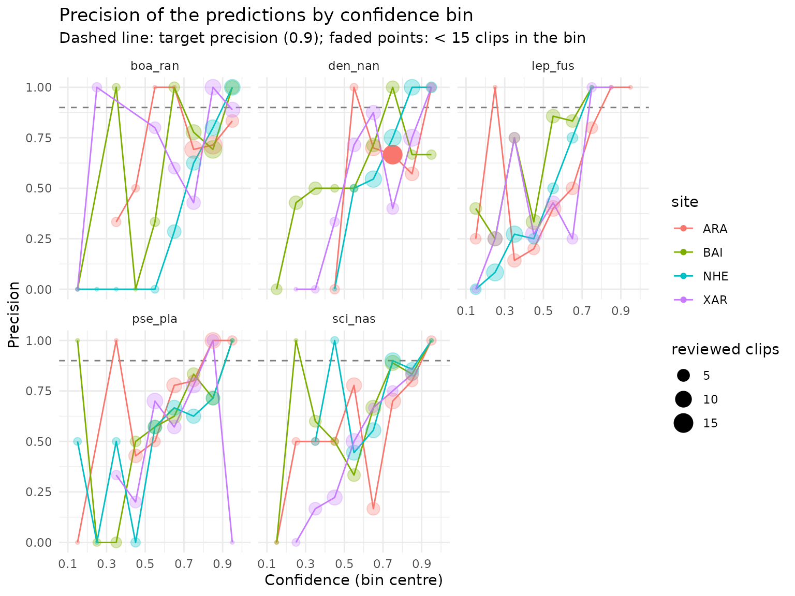

# Get started with sheepdog

sheepdog checks whether the detections of a ‘BirdNET’ custom classifier
are real. Its first stage, covered here, builds a set of clips for
manual review from the BirdNET selection tables and summarises the
verdicts of the reviewers. Calibration (stage 2) and community matrices
(stage 3) are covered in other articles (see [Where next](#where-next)).

``` r

library(sheepdog)
```

## Example data

The package ships a small simulated data set: BirdNET selection tables
(Raven format) of four sites (`ARA`, `XAR`, `BAI`, `NHE`) recorded over
six months (October 2021 to March 2022), with predictions for five
anuran species. False-positive rates vary among species and sites, and
the confidence scores of false positives overlap those of true
detections. The generator is `data-raw/make_example_data.R` in the
source repository. The `Begin Path` column points to recordings on a
fictitious network drive (`N:\pam\audio\...`); the audio files
themselves are not distributed.

``` r

ex <- system.file("extdata", "example", package = "sheepdog")
list.files(file.path(ex, "birdnet"), recursive = TRUE)
#> [1] "ARA/BirdNET_SelectionTable.txt" "BAI/BirdNET_SelectionTable.txt"
#> [3] "NHE/BirdNET_SelectionTable.txt" "XAR/BirdNET_SelectionTable.txt"
```

## Reading the selection tables

[`read_selection_tables()`](https://provetelab.org/sheepdog/reference/read_selection_tables.md)
finds every selection table under a folder, reads them and stacks them.
The site is taken from the name of the folder that holds each table, and
the column names are standardised (e.g. `Begin Time (s)` becomes
`begin_time`).

``` r

det <- read_selection_tables(file.path(ex, "birdnet"))
#> 4 selection table(s) found:
#>   - /home/runner/work/_temp/Library/sheepdog/extdata/example/birdnet/ARA/BirdNET_SelectionTable.txt
#>   - /home/runner/work/_temp/Library/sheepdog/extdata/example/birdnet/BAI/BirdNET_SelectionTable.txt
#>   - /home/runner/work/_temp/Library/sheepdog/extdata/example/birdnet/NHE/BirdNET_SelectionTable.txt
#>   - /home/runner/work/_temp/Library/sheepdog/extdata/example/birdnet/XAR/BirdNET_SelectionTable.txt
#> 5781 predictions read from 4 site(s).
det |>
  dplyr::select(site, species_code, confidence, begin_path, file_offset) |>
  head()
#> # A tibble: 6 × 5
#>   site  species_code                 confidence begin_path           file_offset
#>   <chr> <chr>                             <dbl> <chr>                      <dbl>
#> 1 ARA   Dendropsophus nanus_den-nan       0.727 "N:\\pam\\audio\\AR…           0
#> 2 ARA   Dendropsophus nanus_den-nan       0.670 "N:\\pam\\audio\\AR…         156
#> 3 ARA   Dendropsophus nanus_den-nan       0.682 "N:\\pam\\audio\\AR…         246
#> 4 ARA   Leptodactylus fuscus_lep-fus      0.392 "N:\\pam\\audio\\AR…         276
#> 5 ARA   Dendropsophus nanus_den-nan       0.195 "N:\\pam\\audio\\AR…         291
#> 6 ARA   Leptodactylus fuscus_lep-fus      0.374 "N:\\pam\\audio\\AR…         297
dplyr::count(det, site)
#> # A tibble: 4 × 2
#>   site      n
#>   <chr> <int>
#> 1 ARA    1178
#> 2 BAI    1167
#> 3 NHE    2014
#> 4 XAR    1422
dplyr::count(det, species_code)
#> # A tibble: 5 × 2
#>   species_code                     n
#>   <chr>                        <int>
#> 1 Boana raniceps_boa-ran        1264
#> 2 Dendropsophus nanus_den-nan   1689
#> 3 Leptodactylus fuscus_lep-fus   440
#> 4 Pseudis platensis_pse-pla     1261
#> 5 Scinax nasicus_sci-nas        1127
```

## Selecting the clips to review

[`select_clips()`](https://provetelab.org/sheepdog/reference/select_clips.md)
applies the sampling design to the predictions and returns the clip
manifest, one row per clip to cut. It reads and writes no audio. The
default `"top"` design keeps the `n_top` predictions with the highest
confidence per site x species x night x hour; `max_per_species` then
caps the number of clips per site x species, drawing across the hours of
the night (`balance_by_hour = TRUE`). Because the hour window below
crosses midnight, recordings made after midnight are assigned to the
night before.

``` r

man <- select_clips(det,
                    sampling_mode   = "top",
                    n_top           = 2,
                    hour_start      = 18, hour_end = 2,
                    max_per_species = 40)
#> Sampling mode: top (occasion = file).
#> The hour window crosses midnight: grouping by night (small hours count as the night before).
#> Hour window 18h-2h: 5781 -> 5781 predictions.
#> 0 predictions dropped by the filter confidence < 0.1.
#> 2836 clips selected (top 2 per site x species x night x hour) of 5 species.
#> Limit of 40 clips per species (per site): 2836 -> 800 clips.
dplyr::count(man, site, species_folder)
#> # A tibble: 20 × 3
#>    site  species_folder     n
#>    <chr> <chr>          <int>
#>  1 ARA   boa_ran           40
#>  2 ARA   den_nan           40
#>  3 ARA   lep_fus           40
#>  4 ARA   pse_pla           40
#>  5 ARA   sci_nas           40
#>  6 BAI   boa_ran           40
#>  7 BAI   den_nan           40
#>  8 BAI   lep_fus           40
#>  9 BAI   pse_pla           40
#> 10 BAI   sci_nas           40
#> 11 NHE   boa_ran           40
#> 12 NHE   den_nan           40
#> 13 NHE   lep_fus           40
#> 14 NHE   pse_pla           40
#> 15 NHE   sci_nas           40
#> 16 XAR   boa_ran           40
#> 17 XAR   den_nan           40
#> 18 XAR   lep_fus           40
#> 19 XAR   pse_pla           40
#> 20 XAR   sci_nas           40
```

The `"top"` design serves classifier retraining and the
score-to-probability calibration of stage 2. It should not be used to
estimate false-positive rates, because top-score clips hold fewer false
positives than a random sample; the random designs are described in
[`vignette("sampling-designs")`](https://provetelab.org/sheepdog/articles/sampling-designs.md).

The manifest links each clip to its source recording. Its columns are
defined in
[`vignette("crywolf-integration")`](https://provetelab.org/sheepdog/articles/crywolf-integration.md).

``` r

dplyr::glimpse(man)
#> Rows: 800
#> Columns: 18
#> $ site                  <chr> "ARA", "ARA", "ARA", "ARA", "ARA", "ARA", "ARA",…
#> $ species_code          <chr> "Boana raniceps_boa-ran", "Boana raniceps_boa-ra…
#> $ species_folder        <chr> "boa_ran", "boa_ran", "boa_ran", "boa_ran", "boa…
#> $ recording_date        <chr> "20211201", "20220311", "20220317", "20220106", …
#> $ night                 <chr> "20211201", "20220311", "20220316", "20220106", …
#> $ recording_hour        <chr> "19", "22", "01", "22", "01", "19", "19", "01", …
#> $ rank                  <int> 1, 1, 1, 2, 2, 1, 1, 2, 2, 1, 1, 2, 2, 2, 2, 1, …
#> $ confidence            <dbl> 0.9016, 0.7746, 0.8864, 0.8709, 0.8086, 0.8483, …
#> $ clip_file             <chr> "0.902_1_ARA01_20211201_190000_21.0s_24.0s.wav",…
#> $ clip_start            <dbl> 21, 258, 183, 267, 156, 114, 252, 216, 177, 21, …
#> $ clip_end              <dbl> 24, 261, 186, 270, 159, 117, 255, 219, 180, 24, …
#> $ duration              <dbl> 3, 3, 3, 3, 3, 3, 3, 3, 3, 3, 3, 3, 3, 3, 3, 3, …
#> $ source_audio          <chr> "N:/pam/audio/ARA/ARA01_20211201_190000.wav", "N…
#> $ begin_path            <chr> "N:\\pam\\audio\\ARA\\ARA01_20211201_190000.wav"…
#> $ sampling_mode         <chr> "top", "top", "top", "top", "top", "top", "top",…
#> $ occasion_id           <chr> "ARA01_20211201_190000", "ARA01_20220311_220000"…
#> $ n_detections_occasion <int> NA, NA, NA, NA, NA, NA, NA, NA, NA, NA, NA, NA, …
#> $ inclusion_prob        <dbl> NA, NA, NA, NA, NA, NA, NA, NA, NA, NA, NA, NA, …
```

The columns used below are `species_folder` (the folder of each species
in the review), `night`, `confidence`, `clip_file` (the name of the
clip, unique within the run), and `source_audio` with `clip_start` and
`clip_end` (where the clip is cut from).

## Cutting the clips

[`cut_clips()`](https://provetelab.org/sheepdog/reference/cut_clips.md)
cuts each clip of the manifest into
`<output_dir>/clips/<species_folder>/`, and
[`extract_validation_clips()`](https://provetelab.org/sheepdog/reference/extract_validation_clips.md)
runs reading, selection and cutting in one call, writing
`clip_manifest.csv` and one zip file per species. Both need the source
recordings and the ‘av’ package, so they are not run here. With real
data, check the selection first with `simulate = TRUE`, and remap the
paths of the recordings with `remap_from` and `remap_to` when the drive
is mounted elsewhere:

``` r

extract_validation_clips("N:/pam/birdnet", "N:/pam/validation",
                         max_per_species = 40,
                         remap_from = "N:/", remap_to = "/Volumes/pam/",
                         simulate = TRUE)
```

## The manual review (simulated)

In real use, reviewers listen to the clips in the Review tab of the
BirdNET GUI
(<https://birdnet-team.github.io/BirdNET-Analyzer/stable/usage/gui.html>),
which moves each clip into a `Positive` or `Negative` subfolder of its
species folder. sheepdog reads the verdict from that folder structure.

To make this vignette runnable, the review is replaced by a stand-in:
each clip is declared positive with probability equal to its confidence
score, and an empty `.wav` file with the name of the clip is created in
the corresponding subfolder of a temporary directory. These verdicts are
illustrative only; they are not the simulated truth of the example data,
and they assume a perfect calibration that real classifiers do not have.

``` r

review_dir <- file.path(tempdir(), "sheepdog-review", "clips")

set.seed(1)
verdict <- ifelse(stats::runif(nrow(man)) < man$confidence,
                  "Positive", "Negative")
paths <- file.path(review_dir, man$species_folder, verdict, man$clip_file)
invisible(lapply(unique(dirname(paths)), dir.create,
                 recursive = TRUE, showWarnings = FALSE))
invisible(file.create(paths))

list.dirs(review_dir, full.names = FALSE)
#>  [1] ""                 "boa_ran"          "boa_ran/Negative" "boa_ran/Positive"
#>  [5] "den_nan"          "den_nan/Negative" "den_nan/Positive" "lep_fus"         
#>  [9] "lep_fus/Negative" "lep_fus/Positive" "pse_pla"          "pse_pla/Negative"
#> [13] "pse_pla/Positive" "sci_nas"          "sci_nas/Negative" "sci_nas/Positive"
```

## Summarising the review

[`classify_review()`](https://provetelab.org/sheepdog/reference/classify_review.md)
joins the verdict found in the review folder to the manifest. Clips left
in the species folder are flagged `"not_reviewed"`, and clips that are
not found at all are flagged `"clip_missing"`.

``` r

val <- classify_review(man, review_dir)
#> Clips in the manifest: 800
#>   negative: 316
#>   positive: 484
dplyr::count(val, species_folder, verdict)
#> # A tibble: 10 × 3
#>    species_folder verdict      n
#>    <chr>          <chr>    <int>
#>  1 boa_ran        negative    46
#>  2 boa_ran        positive   114
#>  3 den_nan        negative    55
#>  4 den_nan        positive   105
#>  5 lep_fus        negative    94
#>  6 lep_fus        positive    66
#>  7 pse_pla        negative    59
#>  8 pse_pla        positive   101
#>  9 sci_nas        negative    62
#> 10 sci_nas        positive    98
```

[`precision_by_bin()`](https://provetelab.org/sheepdog/reference/precision_by_bin.md)
gives the share of positive verdicts by site, species and confidence
bin. Bins with fewer than `min_n` reviewed clips are flagged in
`low_support`.

``` r

prec <- precision_by_bin(val, min_n = 15)
head(prec, 10)
#> # A tibble: 10 × 7
#>    site  species_folder bin       n_reviewed n_positive precision low_support
#>    <chr> <chr>          <fct>          <int>      <int>     <dbl> <lgl>      
#>  1 ARA   boa_ran        [0.3,0.4)          3          1     0.333 TRUE       
#>  2 ARA   boa_ran        [0.4,0.5)          2          1     0.5   TRUE       
#>  3 ARA   boa_ran        [0.5,0.6)          1          1     1     TRUE       
#>  4 ARA   boa_ran        [0.6,0.7)          1          1     1     TRUE       
#>  5 ARA   boa_ran        [0.7,0.8)         13          9     0.692 TRUE       
#>  6 ARA   boa_ran        [0.8,0.9)         14         10     0.714 TRUE       
#>  7 ARA   boa_ran        [0.9,1]            6          5     0.833 TRUE       
#>  8 ARA   den_nan        [0.4,0.5)          3          0     0     TRUE       
#>  9 ARA   den_nan        [0.5,0.6)          2          2     1     TRUE       
#> 10 ARA   den_nan        [0.6,0.7)         10          7     0.7   TRUE
```

[`suggest_thresholds()`](https://provetelab.org/sheepdog/reference/suggest_thresholds.md)
returns, for each site and species, the lowest confidence at which the
precision among the clips at or above it reaches `target_precision`,
with at least `min_n` clips. `NA` means that no cut reached the target
with the clips reviewed. With only 40 clips per site x species, many
cells lack the support to reach the target;
[`vignette("validation-effort")`](https://provetelab.org/sheepdog/articles/validation-effort.md)
discusses how many clips are needed.

``` r

suggest_thresholds(val, target_precision = 0.90, min_n = 15)
#> # A tibble: 20 × 5
#>    site  species_folder threshold n_support precision_at_threshold
#>    <chr> <chr>              <dbl>     <int>                  <dbl>
#>  1 ARA   boa_ran            NA           NA                 NA    
#>  2 ARA   den_nan            NA           NA                 NA    
#>  3 ARA   lep_fus            NA           NA                 NA    
#>  4 ARA   pse_pla             0.63        23                  0.913
#>  5 ARA   sci_nas            NA           NA                 NA    
#>  6 BAI   boa_ran            NA           NA                 NA    
#>  7 BAI   den_nan            NA           NA                 NA    
#>  8 BAI   lep_fus            NA           NA                 NA    
#>  9 BAI   pse_pla            NA           NA                 NA    
#> 10 BAI   sci_nas            NA           NA                 NA    
#> 11 NHE   boa_ran             0.77        20                  0.9  
#> 12 NHE   den_nan             0.73        22                  0.909
#> 13 NHE   lep_fus            NA           NA                 NA    
#> 14 NHE   pse_pla            NA           NA                 NA    
#> 15 NHE   sci_nas             0.68        20                  0.9  
#> 16 XAR   boa_ran             0.8         19                  0.947
#> 17 XAR   den_nan            NA           NA                 NA    
#> 18 XAR   lep_fus            NA           NA                 NA    
#> 19 XAR   pse_pla            NA           NA                 NA    
#> 20 XAR   sci_nas            NA           NA                 NA
```

[`nightly_presence()`](https://provetelab.org/sheepdog/reference/nightly_presence.md)
summarises the verdicts by site, species and night: a night is
`"confirmed"` when at least one clip is positive.

``` r

pres <- nightly_presence(val)
head(pres)
#> # A tibble: 6 × 8
#>   site  species_folder night    n_clips n_reviewed n_positive presence          
#>   <chr> <chr>          <chr>      <int>      <int>      <int> <chr>             
#> 1 ARA   boa_ran        20211016       1          1          1 confirmed         
#> 2 ARA   boa_ran        20211101       1          1          0 not_detected_in_r…
#> 3 ARA   boa_ran        20211111       1          1          1 confirmed         
#> 4 ARA   boa_ran        20211116       1          1          1 confirmed         
#> 5 ARA   boa_ran        20211201       2          2          2 confirmed         
#> 6 ARA   boa_ran        20211206       2          2          2 confirmed         
#> # ℹ 1 more variable: max_confidence_positive <dbl>
dplyr::count(pres, species_folder, presence)
#> # A tibble: 10 × 3
#>    species_folder presence                     n
#>    <chr>          <chr>                    <int>
#>  1 boa_ran        confirmed                   74
#>  2 boa_ran        not_detected_in_reviewed    17
#>  3 den_nan        confirmed                   71
#>  4 den_nan        not_detected_in_reviewed    19
#>  5 lep_fus        confirmed                   50
#>  6 lep_fus        not_detected_in_reviewed    35
#>  7 pse_pla        confirmed                   76
#>  8 pse_pla        not_detected_in_reviewed    19
#>  9 sci_nas        confirmed                   69
#> 10 sci_nas        not_detected_in_reviewed    23
```

[`plot_precision()`](https://provetelab.org/sheepdog/reference/plot_precision.md)
draws the precision curve of each species, with the target precision as
a dashed line and bins with low support faded. It needs ‘ggplot2’. With
several sites, each site is drawn as a line of its own colour within the
species panels.

``` r

plot_precision(prec, target_precision = 0.90, min_n = 15)
```



[`retraining_clips()`](https://provetelab.org/sheepdog/reference/retraining_clips.md)
lists the positive clips for retraining the classifier. With real data,
[`post_validation()`](https://provetelab.org/sheepdog/reference/post_validation.md)
runs all of the above in one call and writes each table to a CSV file,
together with the figure.

## Where next

- [`vignette("sampling-designs")`](https://provetelab.org/sheepdog/articles/sampling-designs.md):
  choosing between the `"top"`, `"random_detections"` and
  `"random_recordings"` designs, the inclusion probabilities they
  record, and limits on the review effort.
- [`vignette("validation-effort")`](https://provetelab.org/sheepdog/articles/validation-effort.md):
  how many clips to validate, from the curve of
  [`calibration_effort()`](https://provetelab.org/sheepdog/reference/calibration_effort.md)
  and the support of each site x species cell in
  [`precision_by_bin()`](https://provetelab.org/sheepdog/reference/precision_by_bin.md)
  and
  [`suggest_thresholds()`](https://provetelab.org/sheepdog/reference/suggest_thresholds.md).
- [`vignette("calibration")`](https://provetelab.org/sheepdog/articles/calibration.md):
  calibrating confidence scores (stage 2): the candidate models, their
  cross-validated comparison, calibration curves, scoring of every
  detection and nightly detection histories (`p_min`, k).
- [`vignette("community-matrices")`](https://provetelab.org/sheepdog/articles/community-matrices.md):
  from calibrated detections to community analyses (stage 3):
  [`community_matrices()`](https://provetelab.org/sheepdog/reference/community_matrices.md),
  the `k_min` rule, the effort filter and ordinations with ‘vegan’.
- [`vignette("crywolf-integration")`](https://provetelab.org/sheepdog/articles/crywolf-integration.md):
  the clip manifest and validation tables as input to occupancy models
  with false positives.
- [`vignette("frognet-workflow")`](https://provetelab.org/sheepdog/articles/frognet-workflow.md):
  the complete workflow as used in the FrogNet project.
