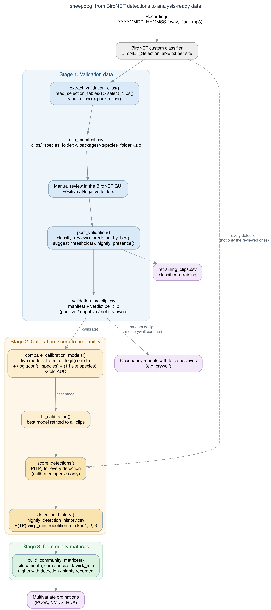

# sheepdog

[](https://doi.org/10.5281/zenodo.22696210)
[](https://provetelab.org/birdnet-validation-sampler/LICENSE.md)

In the fable, the boy cries “wolf!” and the villagers have to decide
whether the wolf is real. **sheepdog** does that check for automated
detections from
[BirdNET](https://github.com/birdnet-team/BirdNET-Analyzer) custom
classifiers in passive acoustic monitoring (PAM). It runs three stages:

1.  **Validation data.** Build clip sets for manual review from the
    BirdNET selection tables: top-score, random-occasion or
    random-recording designs, one folder per species, ready for the
    review tab of the BirdNET GUI. Then summarise the reviewed clips:
    precision by confidence bin, suggested thresholds, confirmed
    presence by night and clips for retraining.
2.  **Calibration.** Turn confidence scores into probabilities of true
    detection with hierarchical logistic models (species and site x
    species effects, compared by cross-validation). Score every
    detection and build nightly detection histories.
3.  **Community matrices.** Turn the calibrated histories into
    effort-standardised site x month matrices for multivariate
    ordinations.

sheepdog was developed for the FrogNet project (anurans of the Pantanal
and Cerrado, Mato Grosso do Sul, Brazil), but it works with the output
of any BirdNET custom classifier. Its validation outputs feed occupancy
models with false positives fitted with
[crywolf](https://github.com/diogoprov/crywolf). The two packages are
independent: sheepdog does not depend on crywolf.



The three stages of sheepdog

## Installation

``` r

# install.packages("remotes")
remotes::install_github("diogoprov/birdnet-validation-sampler")
```

Cutting audio needs [av](https://cran.r-project.org/package=av) (it
bundles ffmpeg), the hierarchical calibration needs
[lme4](https://cran.r-project.org/package=lme4), and the figures need
[ggplot2](https://cran.r-project.org/package=ggplot2):

``` r

install.packages(c("av", "lme4", "ggplot2"))
```

## Usage

``` r

library(sheepdog)

# 1a. Clips to review: check the selection first, then cut
extract_validation_clips("N:/Arara", "N:/Arara/validation",
                         remap_from = "N:/", remap_to = "/Volumes/Arara/",
                         simulate = TRUE)
extract_validation_clips("N:/Arara", "N:/Arara/validation",
                         remap_from = "N:/", remap_to = "/Volumes/Arara/")

# 1b. After the review in the BirdNET GUI
post_validation(review_dir    = "N:/Arara/validation/clips",
                manifest_path = "N:/Arara/validation/clip_manifest.csv",
                output_dir    = "N:/Arara/validation/results")

# 2. Calibration and nightly detection histories
calibrate(validation_files  = c("UEM/validation_by_clip.csv",
                                "ARA/validation_by_clip.csv"),
          prediction_tables = c(UEM = "UEM/BirdNET_SelectionTable.txt",
                                ARA = "ARA/BirdNET_SelectionTable.txt"),
          output_dir        = "calibration")

# 3. Community matrices
build_community_matrices("calibration/nightly_detection_history.csv",
                         "community_matrices",
                         core_species = c("boa_ran", "den_nan", "phy_alb"))
```

Each stage is also available as separate functions:
[`select_clips()`](https://provetelab.org/birdnet-validation-sampler/reference/select_clips.md)
(a pure function that returns the clip manifest without touching audio),
[`cut_clips()`](https://provetelab.org/birdnet-validation-sampler/reference/cut_clips.md),
[`classify_review()`](https://provetelab.org/birdnet-validation-sampler/reference/classify_review.md),
[`compare_calibration_models()`](https://provetelab.org/birdnet-validation-sampler/reference/compare_calibration_models.md),
[`score_detections()`](https://provetelab.org/birdnet-validation-sampler/reference/score_detections.md),
[`community_matrices()`](https://provetelab.org/birdnet-validation-sampler/reference/community_matrices.md)
and others. See
[`vignette("frognet-workflow")`](https://provetelab.org/birdnet-validation-sampler/articles/frognet-workflow.md)
for the complete workflow.

The selection tables must have the standard BirdNET/Raven columns
`Begin Time (s)`, `End Time (s)`, `Species Code`, `Confidence`,
`Begin Path` and `File Offset (s)`, and the recordings must be named
`..._YYYYMMDD_HHMMSS`.

## Sampling designs

[`select_clips()`](https://provetelab.org/birdnet-validation-sampler/reference/select_clips.md)
and
[`extract_validation_clips()`](https://provetelab.org/birdnet-validation-sampler/reference/extract_validation_clips.md)
take `sampling_mode`:

- `"top"` (default) keeps the *N* predictions with the highest
  confidence per site x species x night x hour. It serves retraining and
  the score-to-probability calibration (the model is conditional on the
  score). It does **not** serve to estimate false-positive rates:
  top-score clips hold fewer false positives than a random sample.
- `"random_detections"` follows the observation-confirmation design of
  [Chambert et al. (2015)](https://doi.org/10.1890/14-1507.1): occasions
  with at least one prediction \>= `threshold` are drawn at random
  within strata that do not depend on the score, and every prediction
  \>= `threshold` of a drawn occasion is cut.
- `"random_recordings"` follows the multiple-method design of [Miller et
  al. (2011)](https://doi.org/10.1890/10-1396.1): recordings (or
  minutes) are drawn among all those recorded, with or without
  predictions, for annotation by ear. The clip is the whole recording
  and `confidence` is `NA`.


The first stage, extract_validation_clips()

The manifest records `occasion_id`, `n_detections_occasion` and
`inclusion_prob` (the probability that the occasion was drawn). Every
draw uses a fixed seed, so a rerun selects the same clips, and the cut
is idempotent: an interrupted run resumes where it stopped.

## Calibration

Converting BirdNET confidence scores into probabilities is recommended
by the BirdNET authors ([Wood & Kahl
2024](https://doi.org/10.1007/s10336-024-02144-5)); calibration by
logistic regression on logit(score) is applied, for instance, by [Owens
et al. (2026)](https://doi.org/10.64898/2026.06.01.729442).
[`calibrate()`](https://provetelab.org/birdnet-validation-sampler/reference/calibrate.md)
extends that approach with a hierarchical multi-species structure,

    tp ~ logit(conf) + (logit(conf) | species) + (1 | site:species)

because the same score corresponds to very different probabilities of a
true detection across species and sites. The candidate models are
compared by stratified k-fold cross-validation (AUC).

## Contract with crywolf

`clip_manifest.csv` and `validation_by_clip.csv` are the hand-off to
occupancy models with false positives.
[`vignette("crywolf-contract")`](https://provetelab.org/birdnet-validation-sampler/articles/crywolf-contract.md)
specifies their columns, types and the definition of an occasion;
example files are in `system.file("extdata", package = "sheepdog")`. Do
not pass the whole-recording clips of `"random_recordings"`
(`confidence = NA`) to the `validation` argument of
`crywolf::fp_aggregate()`: they are the second method (manual
annotation), not confirmations of detections.

## From the scripts (v1.2.0) to the package (v2.0.0)

Up to v1.2.0 this repository held four R scripts. Version 2.0.0 turns
them into the sheepdog package, with English function names, arguments,
output columns and values. `NEWS.md` maps every script setting to its
argument and every old column to its new name. The package reads
manifests, validation tables and histories written by v1.2.0, so
validated data stay usable. The scripts are preserved in the [v1.2.0
tag](https://github.com/diogoprov/birdnet-validation-sampler/tree/v1.2.0).

## Authorship and citation

Developed by **Diogo B. Provete** (Universidade Federal de Mato Grosso
do Sul), from the protocol design of **Larissa S. M. Sugai** (Cornell
Lab of Ornithology) and **Liliana Piatti** (UFMS), within the FrogNet
project. Code written with AI assistance (Claude, Anthropic), with human
review and tests.

If sheepdog is useful in your work, please cite it (GitHub’s “Cite this
repository” button uses `CITATION.cff`):

> Provete, D. B. (2026). *sheepdog: sample, validate and calibrate
> BirdNET detections for passive acoustic monitoring* (v2.0.0). Zenodo.
> <https://doi.org/10.5281/zenodo.22696210>

The hex sticker uses a dog silhouette by Mozillian from
[PhyloPic](https://www.phylopic.org/images/d3e8133c-e669-4881-9111-b44145f94212)
(CC0 1.0).

## License

[MIT](https://provetelab.org/birdnet-validation-sampler/LICENSE.md)
