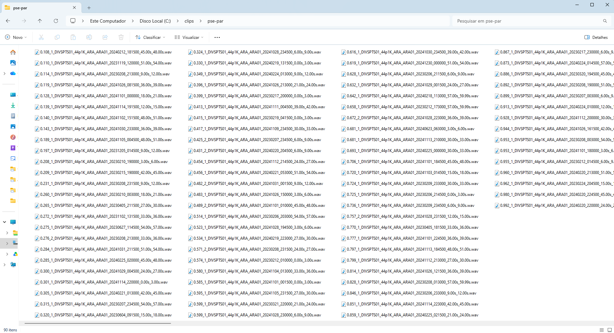
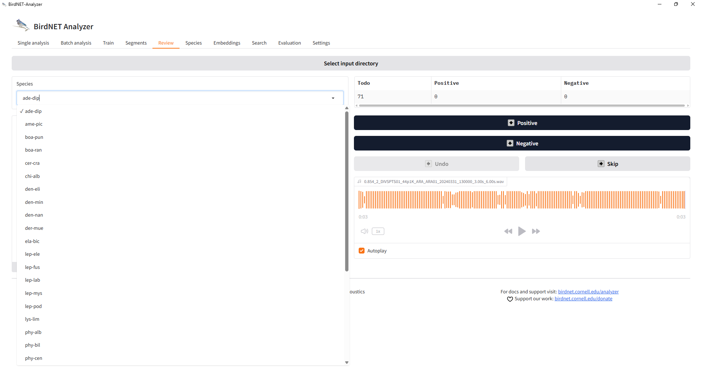
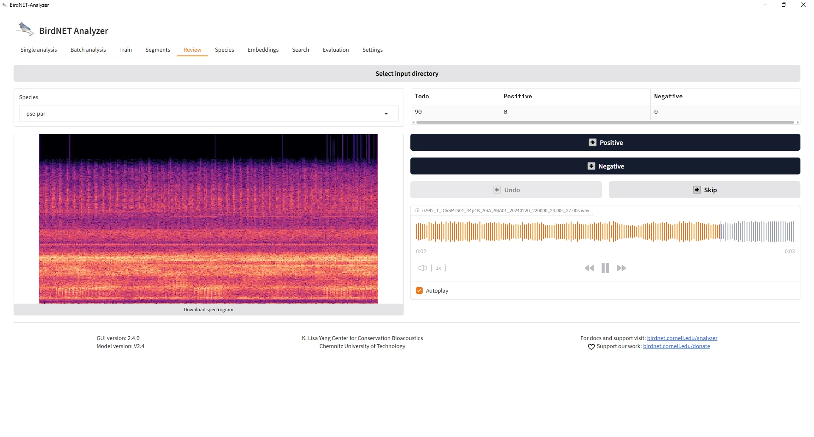
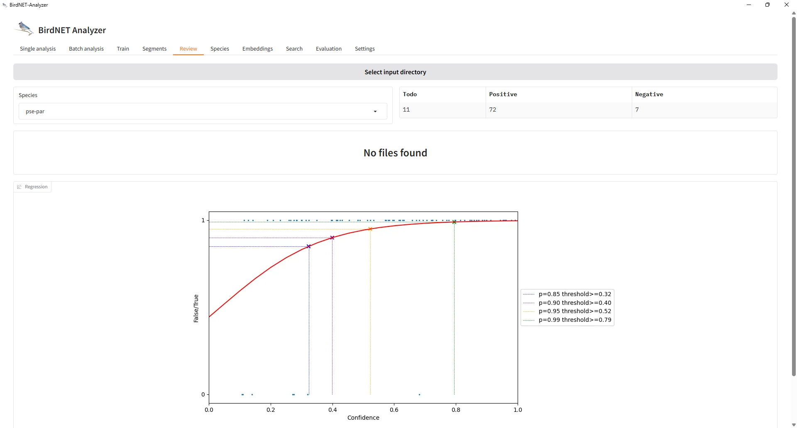
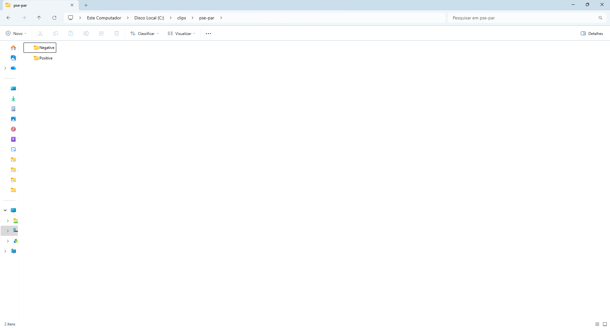
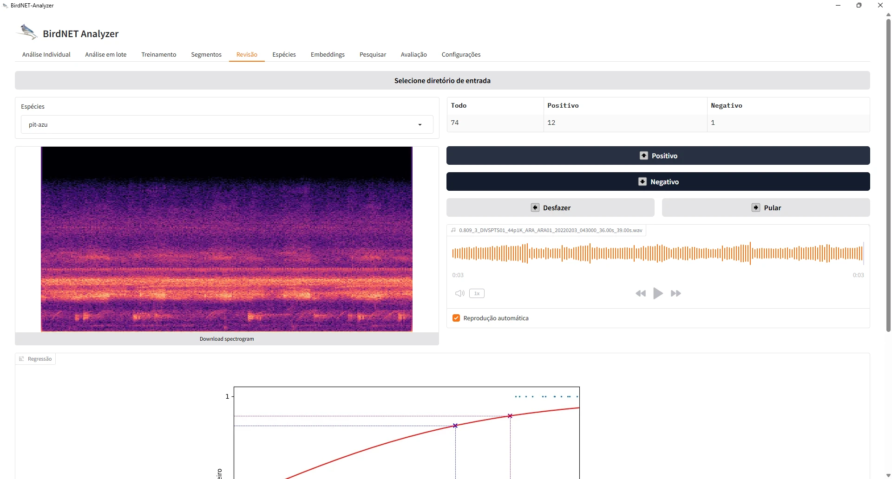
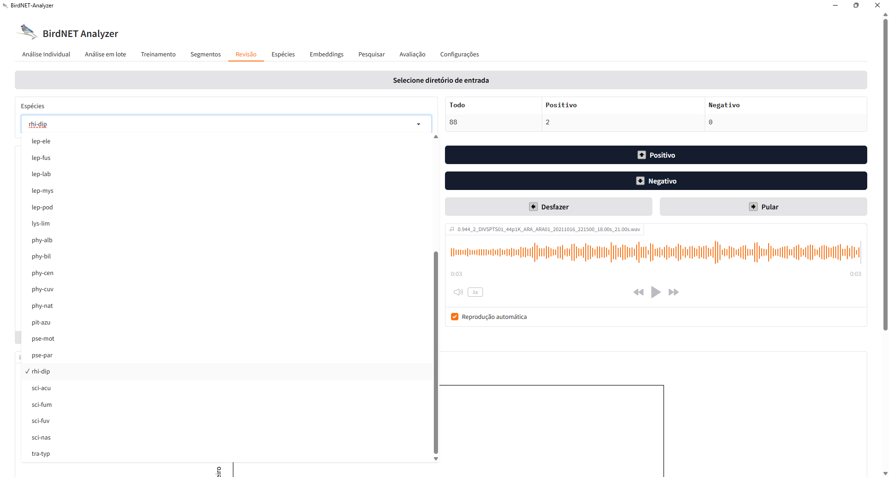
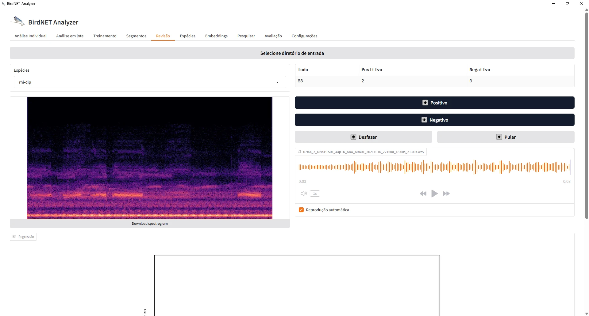
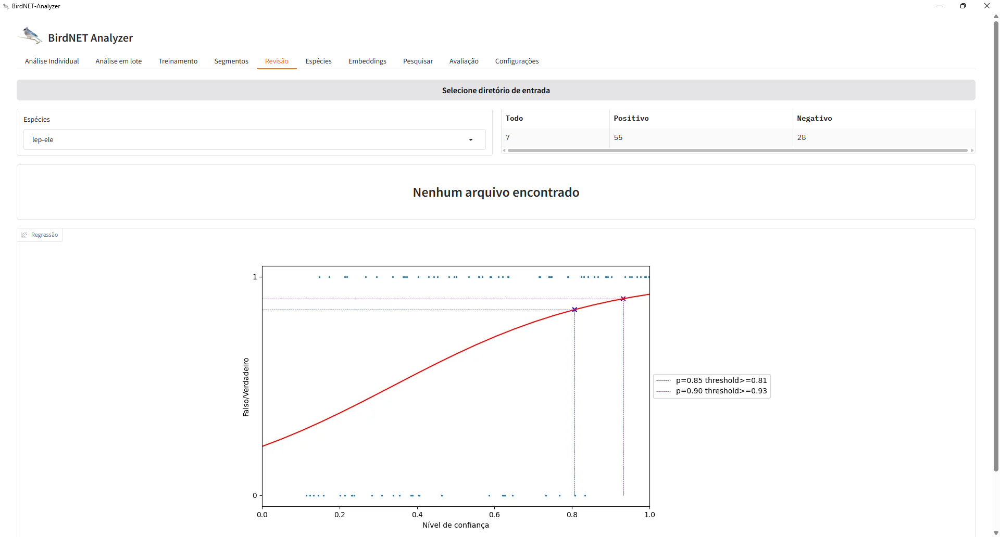

```{r, include = FALSE}
knitr::opts_chunk$set(collapse = TRUE, comment = "#>")
```

> **Tradução.** Este artigo é uma tradução da versão em inglês, que é a referência: [Reviewing clips in the BirdNET GUI](../reviewing-in-the-gui.html). Traduzido da versão 3.2.1 do pacote; se as duas divergirem, vale a versão em inglês.

A revisão manual da etapa 1 é feita fora do R, na aba Review (Revisão) da
GUI do BirdNET-Analyzer. Este artigo descreve essa revisão, desde a pasta
de clipes gravada por `cut_clips()` até as pastas `Positive` e `Negative`
que `classify_review()` lê de volta. As capturas de tela foram feitas com
a versão 2.4.0 da GUI (modelo V2.4) no Windows, com clipes do projeto
FrogNet; o leiaute pode diferir em outras versões. A
[documentação da GUI](https://birdnet-team.github.io/BirdNET-Analyzer/stable/usage/gui.html)
descreve como instalá-la e iniciá-la, e informa que a aba Review (Revisão)
implementa o fluxo de trabalho de Wood & Kahl (2024).

## A pasta de clipes

`extract_validation_clips()` (ou `cut_clips()`) grava uma pasta por
espécie dentro de `clips/`, cada uma com os clipes a revisar. O nome de
cada clipe começa com seu score de confiança e sua posição no ranking,
seguidos do nome da gravação de origem e do início e fim do clipe:



A GUI identifica as espécies pelos nomes dessas subpastas.

## Escolha da espécie

Na aba Review (Revisão), *Select input directory* (selecionar o diretório
de entrada) aponta a GUI para a pasta `clips`. A lista *Species*
(Espécies) passa então a mostrar uma entrada por subpasta, e os contadores
indicam os clipes ainda a revisar (*Todo*) e os já classificados como
*Positive* (*Positivo*) ou *Negative* (*Negativo*):



## Revisão de um clipe

Cada clipe é exibido como um espectrograma, com um reprodutor de áudio
(com *Autoplay*, o clipe é reproduzido assim que é aberto). O nome do
clipe, com seu score, aparece acima da forma de onda. *Positive*
(*Positivo*) e *Negative* (*Negativo*) classificam o clipe e passam ao
seguinte; *Undo* (*Desfazer*) desfaz a última decisão e *Skip* (*Pular*)
avança sem classificar:



Revise o clipe ouvindo-o, e não apenas pelo seu score: o score é
justamente o que a revisão pretende verificar. Nos desenhos aleatórios de
`vignette("sampling-designs")`, a ordem em que os clipes são revisados não
importa, mas todos os clipes de uma ocasião sorteada devem ser revisados
(ver `vignette("crywolf-integration")`).

## O painel de regressão

Depois que alguns clipes foram classificados, o painel *Regression*
(*Regressão*) mostra uma regressão logística dos vereditos em função do
score para a espécie selecionada, com os scores nos quais a probabilidade
predita de uma detecção verdadeira atinge 0,85, 0,90, 0,95 e 0,99:



Essa curva é uma verificação rápida durante a revisão. Ela é ajustada a
uma espécie por vez, agrupando todos os locais, com os clipes revisados
até aquele momento. A calibração da etapa 2 (`calibrate()`,
`vignette("calibration")`) ajusta espécies e locais em conjunto, permite
que a curva varie entre eles, compara os modelos candidatos por validação
cruzada e, com `engine = "brms"`, incorpora a incerteza da curva. Use a
curva da GUI para acompanhar a revisão e a calibração da etapa 2 para as
análises.

## O resultado: pastas Positive e Negative

A GUI move cada clipe classificado para uma subpasta `Positive` ou
`Negative` da pasta da espécie:



Essa é a estrutura que `classify_review()` e `post_validation()` leem. O
veredito de cada clipe vem do nome da subpasta em que ele se encontra,
reconhecido pelas expressões regulares `positive_pattern` (`"positiv"` por
padrão) e `negative_pattern` (`"negativ"`), sem distinção entre maiúsculas
e minúsculas. Um clipe deixado na pasta da espécie, fora de `Positive` e
`Negative` (por exemplo, quando a revisão foi interrompida), é contado
como `not_reviewed`; um clipe do manifesto que não é encontrado em lugar
algum, como `clip_missing`.

```{r, eval = FALSE}
library(sheepdog)
res <- post_validation(review_dir    = "C:/clips",
                       manifest_path = "C:/validation/clip_manifest.csv",
                       output_dir    = "C:/validation/results")
```

## A interface em português

A GUI pode ser configurada em português nas suas configurações (a
tradução é de Larissa Sugai, segundo a documentação da GUI). Os botões
passam a ser *Positivo*, *Negativo*, *Desfazer* e *Pular*, e o painel de
regressão, *Regressão*:







Com a interface em português, a GUI nomeia as pastas de resultado
`positivo` e `negativo` em vez de `Positive` e `Negative`. Os padrões
predefinidos de `classify_review()` (`"positiv"`, `"negativ"`, sem distinção
entre maiúsculas e minúsculas) reconhecem ambos, de modo que a revisão
pode ser lida de volta em qualquer dos dois idiomas, e clipes revisados
em parte em cada idioma recebem o veredito correto.
O painel de regressão de uma espécie com mais falsos positivos tem outro
aspecto: aqui a curva atinge 0,85 apenas no score 0,81, e 0,90 em 0,93, e
as probabilidades mais altas não são atingidas dentro da amplitude de
scores:



Espécies como esta são as que `cell_status()` sinaliza como não
confiáveis em `p_min = 0.95` (ver `vignette("community-matrices")`).

## Vários revisores

Quando os clipes são divididos entre revisores, cada revisor revisa na GUI
a sua própria cópia da árvore de pastas. `assign_reviewers()` divide os
clipes (com uma fração revisada duas vezes), `split_by_reviewer()` os
copia e, após a revisão, `reviewer_agreement()` e `consensus_verdicts()`
medem a concordância e combinam os vereditos:

```{r, eval = FALSE}
man <- assign_reviewers(read.csv("C:/validation/clip_manifest.csv"),
                        reviewers = c("ana", "bia", "caio"), overlap = 0.1)
split_by_reviewer(man, clips_dir = "C:/validation/clips",
                  output_dir = "C:/review")

# after each reviewer has reviewed C:/review/<reviewer> in the GUI
reviews <- lapply(c(ana = "ana", bia = "bia", caio = "caio"), function(r)
  classify_review(man, file.path("C:/review", r)))
reviewer_agreement(reviews)
validation <- consensus_verdicts(reviews)
```

Clipes com veredito conflitantes recebem `verdict = "disagreement"` e
ficam fora da precisão e da calibração até que uma revisão de consenso os
resolva.

## Referências

Wood, C. M., & Kahl, S. (2024). Guidelines for appropriate use of BirdNET
scores and other detector outputs. *Journal of Ornithology*, 165, 777–782.
<https://doi.org/10.1007/s10336-024-02144-5>
